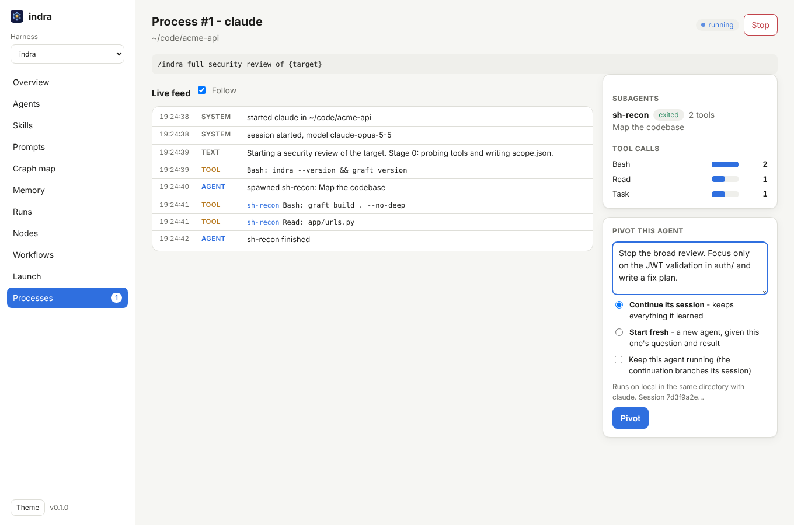

# Pivoting agents

Agents drift: they chase the wrong lead, finish half the job, or the question changes while they
work. **Pivot** gives a running or finished agent a new instruction without throwing away what
it already did. The original process is kept (and by default stopped); a new one starts and
records where it came from.



## Two ways to pivot

| Mode | What the new agent gets | Use it when |
|---|---|---|
| **Continue** (default) | the *same conversation*: the runner resumes the agent's session, so it remembers every file it read and every finding so far, and your text is its next message | you want to steer: "skip the frontend, go deep on the payments service", "write the report now" |
| **Fresh** | a new session whose prompt is your text plus a short brief: what the earlier agent was asked, how it ended, and what it reported | the session is too long or off-track, you want a different runner or model, or the runner cannot resume |

Continue needs a runner that can resume sessions and a session id from the agent. Claude Code
reports one (`session_id` in its stream), so the built-in `claude` runner and any runner with
`format = "claude-stream-json"` can continue. For others, Continue is greyed out and Fresh is
used.

## How to pivot

On a process page, use **Pivot this agent**: type the new instruction, choose Continue or
Fresh, and press Pivot. The new process opens. Its page says "Pivoted from #N (same session)"
or "(fresh)", and the original lists "Pivots: #M".

By default the original is **stopped first**, so two agents never edit the same files at once.
Tick **Keep this agent running** to leave it going; a Continue pivot then *forks* the session
(Claude Code's `--fork-session`), so both agents share the history up to now and diverge from
there. That is how you try two approaches side by side.

Everything is checked before anything is stopped: an unknown mode, a runner or node that is no
longer configured, or Continue on a runner without session support is refused and the original
keeps running.

Over the API:

```bash
curl -s -H "Authorization: Bearer $INDRA_TOKEN" -H 'Content-Type: application/json' \
  -d '{"prompt":"Stop on the frontend. Verify the IDOR in orders and write the report.","mode":"continue","keep_running":false}' \
  http://127.0.0.1:7878/api/procs/3/pivot
# {"id":4}
```

`mode` is `continue` or `fresh`; `keep_running` defaults to `false`.

From a terminal, `indra attach <id>` does the same with `/pivot <text>` (`--fresh` for a fresh
start, `--keep` to leave the original running) and then follows the new process.

To steer by hand rather than with one instruction, start the console with `indra serve --shell`
and press **Open in terminal** (or **Fork in terminal** while the agent runs) on its page: the
agent's own Claude Code session opens interactively in a browser tab, in its directory.

## Where it runs

A pivot runs on the **same node, target and runner** as the original, so a Continue finds the
session where Claude Code stored it (sessions are per machine and per directory). That works
the same for remote nodes: the hub sends the session id in the job and the node runs the
resume.

To move work to *another* machine, use a Fresh-style handoff yourself: copy the original's
outcome from its page into a new **Launch** on the other node. A session cannot follow you
across machines.

## Teaching a custom runner to continue

The built-in `claude` runner already knows how. For another CLI that can resume by id, set
`resume_args` (it must contain `{session}`) and, if it can fork, `fork_args`. They are added
after the runner's normal `args`:

```toml
[[runner]]
name        = "claude-opus"
command     = "claude"
args        = ["-p", "{prompt}", "--output-format", "stream-json", "--verbose", "--model", "opus"]
format      = "claude-stream-json"
resume_args = ["--resume", "{session}"]   # the default for claude-stream-json runners
fork_args   = ["--fork-session"]
```

Session ids are validated (letters, digits, `-`, `_` and `.`, not starting with `-`) before
they reach any command line, and the prompt is still a single argument, never shell text.

## Pivot, retry or re-run?

| You want to | Do this |
|---|---|
| change what an agent is doing, keeping its context | Pivot, Continue |
| start over with the lessons of a failed attempt | Pivot, Fresh |
| try two directions at once | Pivot, Continue, with Keep running |
| re-run a workflow task that failed for a transient reason | set `retries` on the task; it reruns from scratch |
| run the same thing again on another node or target | Launch (or fan-out) with the same prompt |
