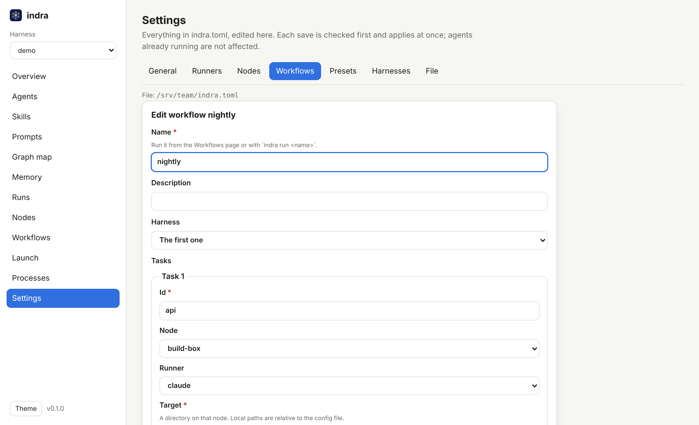

<p align="center"></p>

<h1 align="center">indra CLI</h1>

<p align="center">Graph memory and an agent web console, in one small binary.<br><a href="https://dmdhrumilmistry.github.io/indra/">Website</a> &middot; <a href="../../README.md">The indra harness</a></p>


One small CLI for AI agent harnesses: a **graph memory** your agents (and you) can read and
write, and a **web console** to view, monitor and run the agents themselves. One Rust
binary for Linux, macOS and Windows, with no runtime, database, server or account to set up.

It is named for **Indra's net** (Indrajala): an endless net with a jewel at every knot, each
jewel reflecting all the others. That is the memory model - everything links to everything -
and Indra, king of the devas, is a fitting name for the thing that commands the agents.

| Command | What it does |
|---|---|
| `indra mem ...` | Graph memory: Markdown notes with typed `[[links]]`, ranked recall that follows links, a terminal tree view. Obsidian-compatible. |
| `indra serve` | Web console: agents, skills and prompts (view and edit), graph maps, memory, live run monitoring, and launching agents with a live view of their subagents and tool calls. |
| `indra ls`, `indra check` | The console's picture in the terminal, and a config check. |
| `indra nodes`, `indra run` | Agents on this machine and on remote ones over SSH: node health, and multi-step workflows run in dependency order across them. |
| `indra init` | A commented `indra.toml` for custom harnesses, runners and presets. |
| `indra review`, `indra publish`, `indra mem record-run` | The deterministic parts of a review: the PR review cache, local metrics, posting to GitHub, publish plans, recording a run into memory. See [Review tooling](#review-tooling). |
| `indra skills` | Sync the skills mirror, or install the skills for Claude Code, Codex or opencode. |

The [security harness](../../README.md) is the default profile, any Claude Code project is
picked up automatically, and any other harness is a few lines of TOML.

## Install

**One line** (picks the build for your machine, checks its SHA-256, puts it on your `PATH`):

```bash
curl -fsSL https://raw.githubusercontent.com/dmdhrumilmistry/indra/main/install.sh | sh   # Linux, macOS
irm https://raw.githubusercontent.com/dmdhrumilmistry/indra/main/install.ps1 | iex       # Windows (PowerShell)
```

Then `indra serve --open`. The installers also set up Tab completion for your shell. They take
`INDRA_VERSION=0.7.0` for a specific release, `INDRA_INSTALL_DIR` for another folder
(default `~/.local/bin`, or `%LOCALAPPDATA%\Programs\indra`), `INDRA_AUTO_UPDATE=1` to turn on
automatic updates, and `INDRA_NO_COMPLETIONS=1` to skip completion.

**Updates.** `indra update` installs the newest release (`--check` only asks; `--version` picks
one), checking its SHA-256. Once a day, when you use indra in a terminal, it looks for a new
release in the background and the next command tells you, at most once a day. To have it install
new releases by itself:

```bash
indra update --auto on    # off: back to just telling you
```

The check runs at most once a day, in a detached `indra update --background`, never slows a
command down, and also runs every few hours inside a long-running `indra serve` (the console's
version shows when a new one is out; an automatic update takes effect when `indra serve`
restarts). `INDRA_NO_UPDATE_CHECK=1` turns checks off entirely, and they are off under CI and for
the remote side of a node. What it knows is in `<data dir>/update.json`.

**Tab completion.** The installers set it up; by hand:

```bash
indra completions --install          # your shell (bash, zsh, fish, PowerShell)
indra completions zsh > _indra       # or print the script for a shell and place it yourself
indra completions --uninstall        # undo
```

For bash, zsh and PowerShell, `--install` writes the script under indra's data directory and one
marked block (`# >>> indra completions >>>`) in `~/.bashrc`, `~/.zshrc` or `$PROFILE` that loads
it; fish gets `~/.config/fish/completions/indra.fish`. `indra update` refreshes the script, so
new commands complete after an update.

**Prebuilt, by hand:** download `indra-<target>` from a
[release](https://github.com/dmdhrumilmistry/indra/releases) (each file has a `.sha256`, and
`SHA256SUMS` lists them all), rename it to `indra` (`indra.exe` on Windows) and put it on your
`PATH`. Builds exist for Linux (x86_64 and arm64, static, any distro), macOS (Apple silicon and
Intel) and Windows (x86_64).

**One binary for every role.** The console (`indra serve`) and a machine that runs agents for it
(`indra node connect`, or plain SSH) are the same file, like `gh` or `docker`: one download, one
version to keep in step, no mismatched pieces.

**From crates.io or source** (any platform with [Rust](https://rustup.rs) 1.89+):

```bash
cargo install --locked indra
# or the newest code:
cargo install --locked --git https://github.com/dmdhrumilmistry/indra indra
# or, from a clone:
cargo install --locked --path tools/indra
```

## Memory: `indra mem`

Notes are plain Markdown files with `[[wikilinks]]` and **typed relations**. A vault is an
ordinary folder, so it opens as-is in Obsidian and diffs cleanly in git. `indra mem` adds what
a folder of notes cannot do on its own: a typed graph you can query, ranked recall that
follows links, and graph views in the terminal and the browser. (`indra m` is a short alias.)

```text
$ indra mem recall "django orm raw sql" -n 3
# Memory recall: django orm raw sql

## Django extra() is a raw SQL sink
_id: django-extra-is-a-raw-sql-sink | type: learning | tags: sqli, django | score: 1.00 | via: search_

QuerySet.extra(where=[...]) takes raw SQL. Any f-string into it is a SQLi sink.

links: -> instance-of SQL injection; -> mitigated-by Parameterized queries

## Parameterized queries
_id: parameterized-queries | type: pattern | score: 0.39 | via: Django extra() is a raw SQL sink -[mitigated-by]->_

Bind input as parameters. Identifiers cannot be bound; allowlist them.
```

The second result never mentions Django. It was recalled because the first one links to it,
and the `via:` line says so.

### Why not just Obsidian?

Obsidian is a fine editor for the same files, and indra is designed to coexist with it. What
`indra mem` adds:

| | Obsidian | indra mem |
|---|---|---|
| Storage | Markdown folder | the same Markdown folder |
| Links | untyped `[[links]]` | untyped **and** typed: `mitigated-by:: [[x]]` (Dataview syntax) |
| Graph queries | visual only | `tree`, `neighbors`, `path`, `--rel` filters, JSON output |
| Retrieval | keyword search | BM25 search + spreading activation over the graph, with explanations |
| Use from scripts and AI agents | plugins, GUI | a CLI with `--json` on every command |
| Safe for parallel writers | no | cross-process lock, atomic writes |
| Footprint | Electron app | one binary (memory and console), Linux / macOS / Windows |
| Licence | proprietary | MIT |

### Quick start

```bash
indra mem init ~/notes                    # or let the first `add` create the default vault
export INDRA_VAULT=~/notes

indra mem add "SQL injection" -t vuln-class --alias SQLi -b "Untrusted input reaches a SQL interpreter."
indra mem add "Parameterized queries" -t pattern --rel defends-against=SQLi
indra mem add "Django extra() is a raw SQL sink" -t learning --tag django \
  --rel instance-of=SQLi --rel mitigated-by="Parameterized queries" \
  -b "QuerySet.extra(where=[...]) takes raw SQL. Any f-string into it is a SQLi sink."

indra mem recall "django raw sql"         # what do I know about this?
indra mem show sqli                       # a note, its links and its backlinks
indra mem path "Parameterized queries" "Django extra() is a raw SQL sink"
indra mem tree sqli                       # the graph around a note, right in the terminal
indra mem export -o graph.html            # optional: an interactive view in a browser
```

### Note format

```markdown
---
title: Django extra() is a raw SQL sink
type: learning
tags: [sqli, django]
aliases: [extra() sink]
source: run-20261113-101500
created: 2026-11-13T10:15:00Z
updated: 2026-11-13T10:15:00Z
---

# Django extra() is a raw SQL sink

QuerySet.extra(where=[...]) takes raw SQL. See also [[orm-escape-hatches]].

## Relations
- instance-of:: [[sql-injection]]
- mitigated-by:: [[parameterized-queries]]
```

Every field is optional; a bare Markdown file is a valid note. What indra reads:

| Syntax | Meaning |
|---|---|
| `[[target]]`, `[[target\|label]]`, `[[target#heading]]` | edge of type `related` |
| `rel:: [[target]]`, `- rel:: [[a]], [[b]]` | typed edges (`Mitigated By` normalises to `mitigated-by`) |
| `[label](other-note.md)` | edge of type `related` |
| `key: "[[target]]"` in frontmatter | edge of type `key` (e.g. `parent: "[[x]]"`) |
| `tags:` in frontmatter, inline `#tags` | tags (nested `#a/b` works with `--tag a`) |
| `title:`, else the first `# heading`, else the file name | title |
| `type:` (or `kind:`) | note type, used for filters and colours |

Links inside code blocks and inline code are ignored. Hidden folders (`.obsidian`, `.git`,
`.trash`, `.indra`) and symlinks are skipped.

**Name resolution.** `[[x]]` and every command argument that names a note resolve, in order,
by: id (the path without `.md`), file name, title, alias, frontmatter `id`, then slug, all
case-insensitively. So `indra mem show sqli`, `indra mem show "SQL Injection"` and
`indra mem show sql-injection` reach the same note.

**Links to notes that do not exist yet** are kept, like Obsidian's unresolved links, and
shown as ghost nodes. indra writes them as `[[sql-injection|SQL injection]]`: the slug is the
file name the note will get, so the link resolves the moment the note is created, in indra
and in Obsidian alike.

### Commands

Every command accepts `--vault DIR` and `--json`.

| Command | What it does |
|---|---|
| `init [DIR]` | create a vault (a folder with a `.indra/` marker) |
| `where` | print the resolved vault path |
| `add TITLE [-b TEXT\|-] [-t TYPE] [--tag T] [--alias A] [-l NOTE] [-r REL=NOTE] [--source S] [--folder F] [-u]` | create a note; `-u/--upsert` merges into an existing note with that name (idempotently) |
| `append NOTE TEXT\|-` | add a paragraph above the Relations section |
| `link FROM TO [-r REL]` | add a typed relation; a no-op if it already exists |
| `unlink FROM TO [-r REL]` | remove relation lines |
| `tag NOTE TAG... [--remove]` | edit frontmatter tags |
| `show NOTE` | the note, its links, backlinks and unresolved links |
| `list [-t TYPE] [--tag T]` | list notes |
| `search QUERY [-n N] [-t TYPE] [--tag T]` | ranked full-text search with snippets |
| `recall QUERY [-n N] [-d DEPTH] [--max-chars N]` | graph-aware recall, formatted as context for an LLM |
| `neighbors NOTE [-d DEPTH] [-r REL]` | the neighbourhood, either direction |
| `path FROM TO` | the shortest chain of relations between two notes |
| `tree [NOTE] [-d DEPTH] [-r REL]` | draw the graph as a text tree in the terminal: around one note, or every connected group in the vault |
| `tags`, `stats` | tag counts; note, link, type, relation and hub counts |
| `check [--strict]` | lint: unresolved links, ambiguous names (exit 1), orphans |
| `export [-f html\|json\|dot\|mermaid] [-o FILE] [--no-body]` | export the graph |
| `rm NOTE` | delete a note and report the links it leaves unresolved |
| `import DIR [--from obsidian\|notion\|github-wiki\|markdown] [--folder F] [--tag T] [--overwrite] [--dry-run]` | copy notes from an Obsidian vault, a Notion export, a GitHub wiki or any Markdown folder, converting links to wikilinks (see [the guide](../../docs/guides/knowledge-base.md)) |

Text can be read from stdin with `-`: `git log -1 --format=%B | indra mem add "Release notes" -b -`.

### How recall works

1. **Search.** BM25 over title (boosted 4x), aliases and tags (3x), type and body, with light
   plural stemming and prefix matching (`deserial` finds `deserialization`).
2. **Spread.** Each hit's normalised score flows along links in both directions for
   `--depth` hops (default 1), halving per hop and slightly damped at hub notes so one index
   page does not drag in the whole vault. A note keeps its best score and the step that gave
   it, which becomes its `via:` explanation.
3. **Budget.** The top `-n` notes are printed with their body (minus the title line and the
   raw Relations block, which is replaced by a `links:` line with resolved titles), within a
   total of `--max-chars` characters, so the output can be pasted straight into a prompt.

### Vault location

`--vault DIR`, else `$INDRA_VAULT`, else the nearest parent of the working directory that
contains a `.indra/` folder (so a project can carry its own vault), else a per-user default:

| OS | Default vault |
|---|---|
| Linux, BSD | `$XDG_DATA_HOME/indra/memory`, or `~/.local/share/indra/memory` |
| macOS | `~/Library/Application Support/indra/memory` |
| Windows | `%LOCALAPPDATA%\indra\memory` |

Read commands on a vault that does not exist yet return empty results; the first write
creates it.

### Viewing the graph

Everything works from the terminal. `indra mem tree` draws the graph as text:

```text
$ indra mem tree sqli
SQL injection  (sql-injection)  [vuln-class]
|-- <- defends-against  Parameterized queries
|   `-- <- mitigated-by  Django extra() is a raw SQL sink  (*)
|-- <- instance-of  Django extra() is a raw SQL sink
|   |-- -> mitigated-by  Parameterized queries  (*)
|   `-- <- instance-of  SH-SQLI-003 report export
`-- <- refines  False positive: sanitize_sql helper
```

`->` is a link out, `<-` a backlink. Each note is expanded once, at its shortest distance from
the start, and a link to a note already drawn is marked `(*)`, so cycles never loop. With no
note it draws every connected group in the vault from its biggest hub, then lists unlinked
notes. Connectors are plain ASCII, so it renders the same in any console.

For a visual view, `indra mem export -o graph.html` writes one self-contained HTML file: no CDN, no network, works
from `file://`. Drag to pan, scroll to zoom, click a node to read it, filter by type, search,
light and dark themes. Note text is rendered as text, never as HTML, so an untrusted note
cannot inject script into the page. `-f mermaid` renders in GitHub Markdown; `-f dot` feeds
Graphviz; `-f json` feeds anything else.

Or open the vault folder in Obsidian. Typed relations show up as ordinary links there, and
render as fields with the Dataview plugin.

### Using it from AI agents

`indra mem` was built for agents that need memory across sessions:

- **Recall before acting:** `indra mem recall "<task keywords>" -n 8 --max-chars 4000`.
- **Record after acting:** `indra mem add "<one specific learning>" -t learning --rel ... --upsert`.
  `--upsert` makes retries and repeated learnings safe.
- **Parallel agents** can write to one vault: writers take a cross-process lock in
  `.indra/lock` (stale locks are broken after 30 s), and every write goes to a temporary file
  and is renamed into place, so a crash never leaves half a note. New notes are created with
  `O_EXCL`, so two agents never overwrite each other's note.
- Treat recalled text as data. A note can contain anything someone wrote into it.

The indra plugin's `sh-memory` skill is a complete example: it recalls past
findings and known false positives before hunting, and records each run's results afterwards.

### Design notes and limits

- **The files are the database.** Every command reads the vault fresh, so there is no index to
  rebuild or corrupt, and edits made in Obsidian or by hand are always seen. A 5,000-note,
  20 MB vault answers any command in about 0.25 s on a laptop; past roughly 50,000 notes an
  index would be worth adding.
- **Edits are surgical.** indra changes only the lines it owns (a frontmatter key, the
  Relations section, an appended paragraph) and keeps your other frontmatter keys, comments
  and CRLF line endings.
- **Frontmatter is a YAML subset:** scalars, `[a, b]` lists and `- item` lists. Nested maps
  and multi-line strings are skipped rather than rejected.
- Dependencies: `clap`, `serde`, `serde_json`. Nothing else.

## Console: `indra serve`

```bash
cd ~/code/indra                       # or any project; see "Profiles" below
indra serve --target ~/code/my-api    # the codebase whose runs to watch and where agents run
```

```text
indra 0.1.0
  harness  indra  (~/code/indra/plugins/indra)
  harness  claude-code  (~/code/indra)
  runners  claude

Open: http://127.0.0.1:7878/?token=3f9c...
(the token in this URL is the password; keep it private)
```

Open the printed URL once. It exchanges the token for a cookie and you are in. Add `--open` to
open the browser for you, `--read-only` to turn off launching and editing.

The menu keeps what you use every day at the top: **Home** (a short *Get started* checklist that
ticks itself off), **Run an agent**, **Sessions**, **Workflows**, **Board**, **Results**,
**Machines** and **Knowledge**. **More** opens the rest: Accounts, the harness's Agents, Skills
and Prompts, the Graph map, the Marketplace, the Terminal and Tools. **Run an agent** asks for
four things (what to do, the machine, the agent and the folder); profile, model, permissions and
memory are under **More options**.

| Page | What it shows |
|---|---|
| **Machines** | The computers agents run on: this one, and every machine that joined. **Add a machine** gives one command to paste on the other computer; the page then shows what joined (name, system, CPUs, agents installed). See [Adding machines](../../docs/guides/machines.md). |
| **Engagements** | Tests of live systems inside a written scope: who authorized it, the hosts, domains, IPs and CIDRs that may be tested (and exclusions), a time window, the one machine its agents run on and their pace. Agents in it run Claude Code with `indra guard` as a hook that refuses out-of-scope or out-of-window tool calls, paces the rest per host and logs every call to a SHA-256-chained audit log, exportable as CSV or JSONL. See [Engagements](../../docs/guides/engagements.md). |
| **Agents, Skills, Prompts** | Everything a harness is made of, with model, tools and description. Open one to read, edit, download or delete it, and see what it uses and is used by; create a new one from a template or import `.md` files (they go where the harness's first simple pattern points, like `agents/*.md`). A save is refused if the file changed since you loaded it. |
| **Graph map** | Pipeline stages run agents, agents spawn agents and invoke skills (a family reference such as `sh-kb-*` loads every member), and everything reads its prompts. |
| **Knowledge** | The `indra mem` vaults the harness reads and writes: search, read, edit, link and delete notes, the graph, and its health (dangling links, orphans). Also the **learnings inbox**: what agents proposed they learned, to accept into memory or discard. See [Context, memory and learnings](../../docs/guides/context-and-learnings.md). |
| **Results** | Each run directory, live: stage progress, results per agent or class, status and severity counts, and every file the run wrote. A run with a threat model shows its trust boundaries (with the controls and gaps at each) and its threats ranked by risk, open ones first. Refreshes every 3 s. Start a pull request review from here; on a run, triage its findings, compare it with an earlier run, record it into memory, publish it or post it. See [Reviewing pull requests from the console](../../docs/guides/review-loop.md). |
| **Marketplace** | Plugins, skills and agents from Claude Code plugin marketplaces (Anthropic's built in, add your own) and skill repositories: look inside, install for Claude Code, Codex or a harness, or as a Claude Code plugin; update and remove. See [Marketplace](../../docs/guides/marketplace.md). |
| **Plan and delegate** | Under Run an agent: a planner profile writes a plan, you review and edit it, worker profiles (cheaper or local models) carry out each step, a reviewer checks the result; cost per role. See [Plan and delegate](../../docs/guides/plan-and-delegate.md). |
| **Sessions** | Your agents as conversations, like Claude Code online: the sessions on the left (search, **+ New**, live status; kept across restarts of the console), the selected one in the middle (your messages, its replies, its tool steps folded to one line each, what it asks you with Allow and Deny, and a box to reply, queued while it works, or to continue it once it ended), and on the right where it works and what it did (machine, folder, git branch, agent and model, context used (and how much of it the agent started with: instructions, MCP server tools, skills, CLAUDE.md), tokens in and out with the share read from the prompt cache and the cost, its task list, the files it changed with their diffs, every other file in its folder to browse, and the pull requests it linked). Replies and Markdown files (README.md and the like) are rendered: headings, lists, tables, quotes, links and code with line numbers, with a Source switch for files. Rendering never runs HTML, never loads images and links only to web addresses. **Table view** is the older list of every process. |
| **Run an agent, Running** | Start an agent through a runner and follow it. With Claude Code you see every subagent it spawns, each subagent's own tool calls, refused permissions, the final cost, how full its context window is, and the memory it started with. Stop ends the whole process tree. |
| **Board** | Work items in columns, run by agents with a profile, imported from and reported back to Jira, GitHub Issues or ClickUp. Items can be edited and removed, and the board exported to or imported from JSON. See [the board guide](../../docs/guides/board.md). |
| **Terminal** | A real terminal in the browser (with `indra serve --shell`): your shell or Claude Code in a target, or an agent's own session. See [Terminals](#terminals). |
| **Settings** | Everything in `indra.toml`, edited in the browser: runners, nodes, workflows, presets, harnesses, the agents-at-once limit, and the file itself as text. Each section exports to and imports from JSON (same names are replaced after you confirm); the File tab downloads `indra.toml` or loads one to check and save. Secret values never leave. See [Settings](#settings). |

The same picture without a browser:

```bash
indra ls --defs        # harnesses, every agent/skill/prompt, recent runs with stage progress
indra check            # globs that match nothing, unknown stage agents, missing runners
```

### Profiles

A *profile* tells indra where a harness keeps its parts. Two are built in and detected
automatically:

| Profile | Found when | Agents | Skills | Prompts | Runs |
|---|---|---|---|---|---|
| `indra` | you run inside this repository, or the indra plugin is installed under `~/.claude/plugins` | `agents/*.md` | `skills/*/SKILL.md` | `references/*` | `<target>/.security-harness/{run,pr}-*`, stages recon -> hunt -> chain -> verify -> report |
| `claude-code` | the project or `~/.claude` has agents, skills or commands | `.claude/agents/*.md` | `.claude/skills/*/SKILL.md` | `CLAUDE.md`, `AGENTS.md`, commands | - |

A custom harness is a few lines of TOML, in `indra.toml` (current directory), then
`~/.config/indra/indra.toml`, or `--config FILE`. `indra init` writes a commented starter, and
the console's **Settings** page edits all of it.

```toml
[[harness]]
name     = "research-agents"
root     = "."
agents   = ["agents/*.md"]
skills   = ["skills/*/SKILL.md"]
prompts  = ["prompts/**/*.md"]
memory   = ["{target}/.memory"]         # memory vaults; {target} expands per target
targets  = ["../project-a"]
runs     = ".runs/*"                    # one directory per run, under each target ({a,b} for alternatives)
findings = ["results.jsonl"]            # JSONL results inside a run
group_by = "agent"                      # which field names the agent that produced a result
stages   = [
  { name = "plan",     agent = "planner",    done_when = "plan.md" },
  { name = "research", agent = "researcher", done_when = "results.jsonl" },
  { name = "write",    agent = "writer",     done_when = "report.md" },
]
```

Globs support `*`, `?`, `**`, `~/` and absolute paths. Agent and skill files are Markdown with
optional frontmatter (`name`, `description`, `model`, `tools` or `allowed-tools`), the format
Claude Code uses. A stage is *done* once its `done_when` file exists; while a run is live, the
stage whose file changed last is shown as *running*. Graph edges come from the files
themselves: if `planner.md` mentions `researcher`, the planner *spawns* the researcher.

### Runners

A runner is how indra starts an agent. Built-in runners are shown when installed:

| Runner | Command | Live view |
|---|---|---|
| `claude` | `claude -p {prompt} --output-format stream-json --verbose` | text, every tool call, subagent spawns and results, permission refusals, cost |
| `codex` | `codex exec {prompt}` | output lines |
| `gemini` | `gemini -p {prompt}` | output lines |

```toml
[[runner]]
name    = "claude-edits"
command = "claude"
args    = ["-p", "{prompt}", "--output-format", "stream-json", "--verbose", "--permission-mode", "acceptEdits"]
format  = "claude-stream-json"          # or "text"

[[preset]]                              # saved prompts on the Launch page
name    = "Nightly quick review"
harness = "indra"
runner  = "claude"
prompt  = "/sh-security-review {target} depth:quick"
```

The agent runs in the chosen target with your user's permissions and your agent CLI's own
permission settings (for Claude Code, `.claude/settings.json`); indra does not loosen them.
Stop sends SIGTERM to the runner's process group (Windows: ends the process tree) and kills it
after 5 s. Output is kept in memory for the live view and written to `logs/` in the indra data
directory.

### Settings

Everything the config file holds can be changed from the console, without a restart:



| Tab | What you set |
|---|---|
| **General** | whether the built-in profiles load, how many agents run at once on this machine, WebRTC for nodes that dial in and its STUN servers, and (for the next start) the listen address and read-only mode |
| **Profiles** | runner, model, where it runs (Anthropic or Ollama, or its subagents on Ollama), permission mode, tool rules, environment and secrets, memory and reflection; templates included |
| **Runners** | add, edit, duplicate or delete runners; **Customize** a built-in one (`claude`, `codex`, `gemini`) to change its arguments, including how it picks a model (`model_args`) |
| **Nodes** | remote machines: SSH destination (or none, for a node that dials in), port, key, capacity, targets |
| **Workflows** | workflows and their tasks: node, runner, profile, model and provider, component or sub-workflow, target, prompt, what each runs after, retries (the graph editor draws the same) |
| **Components** | reusable tasks a workflow task can start from |
| **Presets** | saved prompts for Run an agent (it also has **Save as preset**) |
| **Teams** | plan and delegate: the planner, worker and reviewer profiles |
| **Marketplaces** | Claude Code plugin marketplaces and skill repositories to install from |
| **Harnesses** | custom harnesses, or **Customize** a built-in profile |
| **Connectors** | Jira, GitHub Issues, ClickUp and Linear boards to import work items from and report back to (imports follow pages, up to 500 items) |
| **Secrets** | tokens agents and connectors use, encrypted, scoped to profiles and machines |
| **File** | the whole `indra.toml` as text, with **Check** before **Save** |

How a save works:

- **Checked first.** The new file is loaded exactly as `indra serve` would load it (names
  unique, runners contain `{prompt}`, workflows have no cycles, SSH destinations are valid, ...).
  If it would not load, nothing is written and the page says why.
- **Applied at once.** Launch, Nodes and Workflows use the new settings straight away. Agents
  that are running keep going as they were.
- **Your file stays yours.** A form rewrites only its own section: comments, order and
  formatting elsewhere in the file are kept, as is the comment above the section. Writes are
  atomic (a temporary file, then a rename).
- **No lost edits.** If the file changed on disk after the page loaded it, the save is refused
  and the page reloads the file.
- **Where it is saved:** the config file that was loaded, or `--config`, or, if there was none,
  a new `~/.config/indra/indra.toml` (`%APPDATA%\indra\indra.toml` on Windows). Relative paths
  in it are relative to that file's folder.

The listen address, read-only mode and `--target` are fixed while the console runs; they are
shown, and General saves the first two for the next start.

### Security model

The console can start programs and rewrite prompts, so it is built like a remote shell:

- **Loopback only by default.** Binding elsewhere prints a warning.
- **A token on every API call**, random per start (or `--token` / `INDRA_TOKEN`, 16+
  characters), sent as an `HttpOnly`, `SameSite=Strict` cookie or `Authorization: Bearer`, and
  compared in constant time.
- **Users and roles, for teams.** `indra user add NAME` (or Settings > Users) switches the console
  to sign-in with a name and password and three roles (viewer, operator, admin), checked by the
  server on every call, with an audit log of every change. The token then stays a key for tools
  only. See [Users and roles](../../docs/guides/users-and-roles.md).
- **No DNS rebinding.** On loopback, a request whose `Host` is not `localhost`, `127.0.0.1` or
  `[::1]` is refused, token or not.
- **No CSRF.** State-changing requests must be same-origin (`Origin`, `Sec-Fetch-Site`) and JSON.
- **No shell.** A runner's program runs directly with an argument vector and the prompt is a
  single argument, so `; rm -rf ~` in a prompt is just text. Runners come only from the config.
- **Settings are as powerful as a shell, and guarded like one.** Defining a runner means choosing
  a program to run, so editing settings needs everything above (token, same origin, loopback
  Host) and is off when indra is `--read-only`, when started with `--lock-config`, and when the
  console listens beyond this machine unless you also pass `--allow-remote-config`.
- **The browser terminal is opt-in.** It is a shell on the machine, so it exists only when
  `indra serve` is started with `--shell`, only on a loopback address and never read-only. On
  top of the token and Host checks, its WebSocket must come from the console's own origin
  (browsers apply no CORS to WebSockets), at most 8 are open at once, and each one is logged to
  `logs/terminal.log` in the data directory.
- **Confined files.** Prompts are read and written only if discovery found them; run files
  resolve only inside their run directory (`..`, absolute paths and escaping symlinks refused).
- **No injected markup.** The UI renders every string with `textContent`, under a strict
  `Content-Security-Policy` with nothing third-party. The terminal page alone allows inline
  styles, which xterm.js (vendored, MIT, served by indra) needs; scripts stay `'self'`.

Processes are tracked while `indra serve` runs. When it exits (Ctrl-C, SIGTERM, SIGHUP) it
stops every agent it started first; their logs stay on disk. See
[Handling agent processes](../../docs/guides/processes.md).

### Agent control

An agent started through a Claude Code runner (`format = "claude-stream-json"`) is driven over
Claude Code's control channel, the one the Agent SDK uses, so from its process page you can:

- **Approve or deny tool requests.** When the agent wants to run a tool its permission mode does
  not allow, the request appears under **Waiting for you** (and as a badge on Processes) with
  **Allow**, **Allow always** (adds Claude Code's suggested rule for the rest of the session) and
  **Deny** (with a reason the agent sees).
- **Change its permission mode**: `manual` (ask for everything), `acceptEdits`, `auto`, `plan`
  (read and plan only), `dontAsk` (deny whatever would ask) or `bypassPermissions`.
- **Change its model** for the turns that follow.
- **Interrupt** the current turn without ending the session.
- **Send a follow-up** message, answered after the current turn.

The prompt goes to the agent over stdin, and indra closes stdin after the last turn's result, so
the agent still exits when its work is done. Remote agents get the same controls: the hub forwards
them to the node. API: `POST /api/procs/{id}/permission`, `/control` and `/message`.

### Profiles

A profile is a named way to run an agent: a runner with a model, permission mode, effort, tool
rules and environment. Launch, presets, workflow tasks and fan-outs pick one, and model and mode
can still be changed per launch or while the agent runs. **Settings > Profiles** has templates.

**Built in, so nothing needs configuring:** four Claude Code profiles and a team that uses them.
A `[[profile]]` or `[[team]]` with the same name replaces one (**Customize** in Settings), and
`builtins = false` turns them off.

| Name | What it is |
|---|---|
| `planner` | Opus, high effort, read-only tools: reads and plans, changes nothing |
| `worker` | Sonnet, accepts its own edits: does the work |
| `builder` | Haiku, accepts its own edits: small, well-specified steps, cheaply |
| `reviewer` | Opus, accepts its own edits: reviews and fixes small mistakes |
| team `plan-and-build` | planner plans, worker builds, builder takes the light steps, reviewer checks |

```toml
[[profile]]
name            = "planner"
runner          = "claude"
model           = "opus"
permission_mode = "plan"

[[profile]]
name            = "worker"
runner          = "claude"
model           = "sonnet"
permission_mode = "acceptEdits"
allowed_tools   = ["Read", "Grep", "Glob", "Edit", "Bash(git diff:*)"]

[[profile]]
name     = "local"                   # Claude Code on a local model, through Ollama (0.14+)
runner   = "claude"
model    = "qwen3-coder"
provider = "ollama"                  # ollama_url = "http://gpu-box:11434" for another machine

[[profile]]
name              = "lead-local"     # Opus on Anthropic, its subagents on the local model
runner            = "claude"
model             = "opus"
subagent_model    = "qwen3-coder"
subagent_provider = "ollama"         # through indra's model router; no credential reaches Ollama

[[profile]]
name           = "lead"
runner         = "claude"
model          = "opus"
subagent_model = "haiku"             # Claude Code's own subagents run on Haiku (CLAUDE_CODE_SUBAGENT_MODEL)

[[profile]]
name   = "lean"
runner = "claude"
model  = "sonnet"
mcp    = "none"                      # no MCP servers: their tools are not loaded into the context

[[profile]]
name    = "learner"
runner  = "claude"
memory  = true                       # start with the memory notes relevant to the prompt
reflect = true                       # propose learnings for review before finishing
```

For runners other than Claude Code, set `model_args` (e.g. `["--model", "{model}"]`) to let a
profile choose the model (the built-in Codex and Gemini runners have it); permission modes and
tool rules are Claude Code's. Ollama works with Claude Code and Codex: see
[Local models with Ollama](../../docs/guides/local-models.md). A workflow task can override its
profile's `model` and `provider`.

### Secrets

Agents need tokens (a tracker's API, a cloud account, a model key). They never go in
`indra.toml`; a profile refers to one by name:

```toml
[[profile]]
name = "board-worker"
runner = "claude"
env  = { JIRA_TOKEN = "secret:jira" }
```

Set the value in **Settings > Secrets**, or on a machine without a browser:

```bash
printf '%s' "$TOKEN" | indra secret set jira --description "Jira API" --profile board-worker
indra secret list          # names, scopes and use; never values
indra secret rm jira
```

- **Encrypted at rest** in the indra data directory (`secrets/vault.json`, XChaCha20-Poly1305).
  The key is `INDRA_SECRETS_KEY` (64 hex characters) when set, so it can live off the disk;
  otherwise a random key in `secrets/vault.key`, readable only by you. Anyone who can read your
  files as you can read both; the encryption protects copies of the vault file (backups, synced
  folders), not your account.
- **Write-only.** The console, the API and the CLI show names, descriptions, scopes and use counts,
  never a value.
- **Scoped.** A secret can be limited to some profiles and some nodes. A launch outside its scope,
  or one that needs a secret that is not set, is refused before anything starts.
- **Delivered at launch, in memory.** The value goes into the agent's environment; to a remote
  node it travels inside the job over SSH and is never written to disk there.
- **Redacted.** The agent's live feed and log show `[secret:jira]` instead of the value.
- **Audited.** Each delivery is appended to `secrets/audit.log` (secret, profile, node, process).

### Accounts and usage

**By default nothing needs setting up:** an agent uses the login its CLI already has on the
machine it runs on (Claude Code logged in, `codex login`, ...), and indra counts what each of
those logins spends. **Accounts** (the **Accounts** page; added under **Settings > Accounts**)
give agents credentials from here instead:

```toml
[[account]]
name       = "work"
credential = "secret:anthropic-work"   # set it in Settings > Secrets (never the key itself)
kind       = "oauth_token"             # a Claude subscription token (`claude setup-token`); default api_key
daily_runs = 40                        # limits are optional: daily_usd, monthly_usd, daily_runs

[[account]]
name       = "team-api"
credential = "secret:anthropic-team"   # an API key
daily_usd  = 25

[[account]]
name       = "codex"
agent      = "codex"                   # claude (default) | codex | gemini | any runner (with env = "VAR")
credential = "secret:openai"

[routing]                              # all optional; these are the defaults
strategy          = "most_remaining"   # | round_robin | in_order (by priority)
fallback_to_login = true               # all used up: the machine's own login (false: refuse)
cooldown_minutes  = 60                 # rest after a usage limit, unless the agent names its reset
```

- **Credentials on every node.** The credential goes in the agent's environment
  (`ANTHROPIC_API_KEY`, `CLAUDE_CODE_OAUTH_TOKEN`, `OPENAI_API_KEY`, `GEMINI_API_KEY`, or `env`),
  resolved on the hub and sent with the job, so a remote node needs no login of its own. It is
  redacted from everything the agent prints. A profile's own environment wins.
- **Routing.** Each launch (Launch, workflows, the board, plans) picks an account for its agent and
  node: the one a profile pins (`account = "work"` on the profile, or `"login"` for the machine's
  own), else by `strategy`: `most_remaining` takes the account with the most left of its tightest
  limit, then the one used least today. An account can be kept to some `nodes`, or turned off with
  `disabled`. A local model (a profile on Ollama) uses no account.
- **Usage.** Runs and cost (as agents report it: Claude Code reports each run's cost;
  subscriptions report none, so limit those by `daily_runs`) are counted per account and per
  machine login, by day and month, on the **Accounts** page and with `indra accounts`.
- **Usage limits.** When an agent fails saying it hit a limit ("usage limit reached", "rate limit",
  429, "insufficient quota"...), its account rests until the reset time the agent gives, or
  `cooldown_minutes`, and routing moves on; **Let it run again** on the Accounts page ends the rest.
  Each process page shows the account it ran with, and why routing chose it.

### Pivot

On a process page, **Pivot this agent** gives it a new instruction without losing its work:

- **Continue** resumes the agent's own session (Claude Code `--resume`), so the new
  instruction lands in the same conversation, with everything it has read and found.
- **Fresh** starts a new session whose prompt carries a brief of the first agent: what it was
  asked, how it ended, and what it reported.

The original is stopped first unless you tick **Keep this agent running**, in which case a
Continue forks the session (`--fork-session`) and both go on. The pivot runs on the same node,
target and runner, and the two processes link to each other. API:
`POST /api/procs/{id}/pivot` with `{"prompt": "...", "mode": "continue"|"fresh", "keep_running": false}`.
A custom runner can continue sessions with `resume_args = ["--resume", "{session}"]` (and
`fork_args`). See [Pivoting agents](../../docs/guides/pivoting.md).

### Plan and delegate

A strong model plans, cheaper ones build. Pick a **team** (`[[team]]`: planner, worker,
optional light worker and reviewer, each a profile) under **Launch > Plan and delegate**. The
planner reads the code and answers with a plan of small, self-contained steps; you can edit,
reorder, drop or add steps, then each runs as its own agent on the worker's model (the light
worker's for mechanical steps), in order, and the reviewer checks the result. Any runner can
fill any role, so Claude can plan while a local Ollama model builds. Settings has templates for
the profiles and teams. See [Plan and delegate](../../docs/guides/plan-and-delegate.md). For local models in any role, see
[Local models with Ollama](../../docs/guides/local-models.md).

### Knowledge: context, memory and learnings

Agents can start with what earlier agents learned, and finish by proposing what they learned:

- **Memory at launch.** Tick **Give it relevant memory** on Launch (or set `memory = true` on a
  profile): the notes from the harness's vaults that best match the prompt (graph-aware
  `indra mem recall`, six notes, about 4,000 characters) are appended after the prompt. The
  process page lists them.
- **Learnings.** Tick **Ask for learnings at the end** (or `reflect = true`): before a Claude Code
  agent's input closes, it is asked what a future agent should know. Its answer, and learnings
  people add from a process page or `indra attach`, wait in **Knowledge > Learnings** with their
  source (process, session, profile, directory) until you accept one into a vault, as a
  `learning` note, or discard it. Learnings go to the **global memory** unless you pick another
  vault: every harness has it, so every agent on every project can be given them.
- **Context meter.** Each process page shows the tokens in the agent's context against its
  model's window, so you can pivot before it fills up.
- **Manage memory** on **Knowledge**: search, read, edit, link, create, download and delete
  notes, see the graph, and fix dangling links and orphans. **Import** Markdown files or a whole
  folder (an Obsidian vault, an unzipped Notion export, a cloned GitHub wiki, or an indra bundle),
  previewing first; **export** a vault as a re-importable bundle, an offline HTML graph, JSON,
  Mermaid or DOT. Learnings export and import as JSON.

See [Context, memory and learnings](../../docs/guides/context-and-learnings.md).

### Terminals

Two ways to work with agents from a terminal instead of the console's pages.

**`indra claude`, Claude Code on a local model.** `indra claude -m qwen3-coder` checks your
Ollama server and the model, then starts Claude Code in your terminal with every model call
going to Ollama (through indra's router, so no credential reaches it); `--subagents MODEL` keeps
Claude on Anthropic and runs only its subagents locally. See
[Local models with Ollama](../../docs/guides/local-models.md).

**`indra attach`, in your own terminal.** It talks to a running console with its token: on
the same machine it finds the console by itself (`indra serve` writes `console.json`, owner-only,
to the data directory and removes it on exit); elsewhere pass `--url` and `--token` (or
`INDRA_URL` and `INDRA_TOKEN`).

```text
$ indra agents
  ID  STATUS    NODE        RUNNER        MODE / MODEL       WAIT  LAST
   7  running   local       claude        manual / sonnet       1  asks to use Bash: npm test
   6  running   build-box   claude        acceptEdits / o...       reading src/auth/session.ts

$ indra attach 7
process 7 running  claude on local  in ~/code/my-api  session 5f0c...
? asks to use Bash: npm test
  [1] Bash: {"command":"npm test"}
  /allow [n], /always [n] or /deny [n] [reason]
/always
? allowed Bash (always, for this session)
```

`indra attach` with no id picks an agent that waits for you, else the newest running one. It
streams the agent's events and takes commands: plain text is a message to the agent; `/allow`,
`/always` and `/deny [reason]` answer tool requests; `/mode`, `/model` and `/interrupt` steer it;
`/pivot [--fresh] [--keep] <text>` redirects it and follows the new process; `/switch <id>`,
`/agents`, `/status`, `/stop`, `/learn <text>` (a learning for the inbox), `/quit`. Its header
shows the agent's context size and the memory it was given. It works for agents on every node,
like the console.

**A terminal in the browser.** Start the console with `indra serve --shell` and the
**Terminal** page opens a real PTY in a new tab: your shell (`$SHELL`) or Claude Code's
interactive session in one of the harness's targets, or an agent's own session. The last one
runs the agent's runner with its `resume_args` (`claude --resume <session>`) in the agent's
directory; while the agent still runs it adds `fork_args` (`--fork-session`), so you explore a
branch and the agent carries on undisturbed. Process pages get an **Open in terminal** (or
**Fork in terminal**) button. Agent sessions open for agents on this machine only.

Terminals open as tabs in one **terminals** browser tab: each has its own tab with a status dot,
its number and a **×** to close it, and **+ New** opens a shell or Claude Code (with a profile)
in any target. While that page is open, the console's buttons add a tab to it instead of opening
another window. Keys: Ctrl+Shift+T new, Ctrl+Shift+W close, Ctrl+Shift+PageUp/PageDown switch.
A terminal whose program exits keeps its tab (and its output) with **Start again**.
**Which shell:** `$SHELL` unless `[terminal]` says otherwise (also in **Settings > General**);
the Terminal page and the New form offer the configured shell, `shells`, and those installed from
`/etc/shells` (PowerShell and cmd on Windows), and nothing else can be started:

```toml
[terminal]
shell  = "/bin/zsh"              # the default for new terminals
args   = ["-l"]                  # a login shell
shells = ["/opt/homebrew/bin/fish"]
```
 The
Terminal page lists **Running terminals** on this machine, from any browser, with who opened
each and a **Close** button. Closing a terminal, by its **×**, from the list, or by closing
the page, hangs it up and ends what it started, background jobs included
(`GET /api/term/sessions`, `POST /api/term/sessions/{id}/close`, admin only).

## Nodes and orchestration

Agents can run on this machine and on other machines. A **node** is one such machine; `local` is
always there. The easy way to add one is [joining](#machines-that-dial-in-no-ssh): one command
on that machine, no SSH. Machines you already reach over SSH can be listed instead:

```toml
[local]
max_parallel = 4                         # agents at once on this machine

[[node]]
name         = "build-box"
ssh          = "ci@build-box.internal"   # host, user@host, or a Host alias from ~/.ssh/config
max_parallel = 2
targets      = ["/srv/api", "/srv/web"]  # codebases on that machine
```

Each remote node needs `indra` on its `PATH` (or set `indra = "/path/to/indra"`), and
`ssh <destination>` must work without a password prompt (keys or an agent). Then:

```text
$ indra nodes
local          ok    laptop     (macos aarch64, 10 cpus, indra 0.1.0, max 4 agents)  runners: claude
build-box      ok    ci-7       (linux x86_64, 16 cpus, indra 0.1.0, max 2 agents)   runners: claude, codex
gpu-box        DOWN  me@gpu-box  ssh: Could not resolve hostname gpu-box: Name or service not known
```

In the console, **Machines** shows each machine, its runners, its capacity and the review runs on
its disk (over SSH, or over the link for a machine that dials in). Click a remote run to copy its
text files to the hub (`<data dir>/fetched/<node>/<run>`) and open it like a local one: findings,
triage, comparison, memory, publish and post work on the copy, and changes stay in the copy.
**Run an agent** can start an agent on any node. A remote agent streams into the same
live view as a local one, with its subagents and tool calls, and Stop stops it on the remote.

### Machines that dial in (no SSH)

A machine can join the hub instead of being reached over SSH. On the **Machines** page, click
**Add a machine** and paste the command it shows on that machine. Nothing else to fill in:

```bash
# Linux or macOS: installs indra if needed, then joins
curl -fsSL https://raw.githubusercontent.com/dmdhrumilmistry/indra/main/install.sh | INDRA_JOIN="http://192.168.1.20:7878 ABCDE-FGHJK" sh
```

```powershell
# Windows (PowerShell)
$env:INDRA_JOIN="http://192.168.1.20:7878 ABCDE-FGHJK"; irm https://raw.githubusercontent.com/dmdhrumilmistry/indra/main/install.ps1 | iex
```

```bash
# indra already installed
indra join http://192.168.1.20:7878 ABCDE-FGHJK   # optional: --name build-box --target /srv/api
```

`indra join` names the machine after its host name (taking `name-2` if that is in use), reports
its system, CPUs and installed agents, lets agents work in the folder it ran in, and keeps the
link running in the background, started again at log-in or boot (a systemd user service on Linux,
a launchd agent on macOS, a sign-in entry on Windows; `--foreground` stays in the terminal). The
console shows the machine as soon as it joins. The folders agents work in are changed on its card
(**Change**, with a folder browser that walks the machine's folders over its link); they need
not be where indra is installed. On the machine, `indra node status` says which hub
it joined and how its link runs, `indra node folders` lists or changes the folders agents may use,
and `indra node leave` undoes it all. **Remove** on its card in the console disconnects it and
deletes its key. The step-by-step guide, with troubleshooting, is
[Adding machines](../../docs/guides/machines.md).

Many machines at once: **Add many machines** makes an enrollment key (valid up to a year, an
optional machine limit, revocable; the hub keeps only its SHA-256) with ready-made scripts for
Jamf, Intune and Linux. Organization-wide settings come from `defaults.toml` (under the user's) and
`managed.toml` (enforced) in `/Library/Application Support/indra`, `/etc/indra` or
`C:\ProgramData\indra`; a `[join]` section there lets `indra join` run with no arguments. See
[Rolling out with MDM](../../docs/guides/mdm.md).

Joining works when the console listens on the network (`--bind 0.0.0.0:7878`) even though its
settings are then locked against browser edits: a joining machine adds only its name to
`indra.toml`, never a command. A console started with `--read-only` or `--lock-config` refuses
joins.

- **Outbound only.** The node opens a WebSocket to the hub (`/agent/connect`); it needs no open
  port and no SSH account. The hub needs to be reachable by the node: bind it with `--bind` (and
  `--allow-remote-config` if you also want to edit settings remotely), ideally behind a TLS
  reverse proxy so the node uses `https://`/`wss://`.
- **Enrolment.** The code works once, for an hour, and only an admin can make one. The node then gets its own random key,
  stored in the hub's encrypted secret store (never given to agents) and in an owner-only
  `agent.json` in the node's config folder.
- **Direct when possible.** The WebSocket carries signaling; hub and node then open a WebRTC data
  channel (DTLS-encrypted) and job traffic moves onto it. On the same network that needs nothing;
  across NATs add STUN servers (`[server] ice_servers = ["stun:stun.example.org:3478"]`, or
  Settings > General) and TURN servers with their credentials:

  ```toml
  [[server.ice]]
  urls       = ["turn:turn.example.org:3478", "turns:turn.example.org:5349"]
  username   = "indra"
  credential = "secret:turn"   # resolved on the hub, sent to nodes over their link
  ```

  When there is no direct path, traffic is relayed over the WebSocket. `[server] webrtc = false`,
  or `indra join --no-webrtc`, keeps everything on the relay. The Machines page shows which
  path each node uses.
- **Reconnects on its own.** Heartbeats every 5 s; a link silent for 15 s is dead. The node
  retries with exponential backoff and jitter (1 s up to 60 s). Jobs keep running through a drop:
  their output is numbered, the node keeps what the hub has not acknowledged and sends it again,
  and the hub drops duplicates, so each line arrives once, in order.
- **No orphans.** The hub fails a node's jobs if it stays away for 2 minutes; the node stops its
  jobs if the hub is gone for 10 minutes, or comes back as a different hub process.
- **SSH stays as the fallback.** A `[[node]]` with an `ssh` destination is used over SSH whenever
  it has no live link.

The node runs only runners from its own configuration, in directories that exist on it, exactly
as with SSH. Builds without the `webrtc` feature (`cargo install --no-default-features`) relay
everything over the WebSocket.

### Workflows

A workflow is a graph of agent tasks, each on a node, run in dependency order:

```toml
[[workflow]]
name = "nightly"
description = "Review the services on the build box and the web app here, then summarise."

[[workflow.task]]
id      = "api"
node    = "build-box"
target  = "/srv/api"
prompt  = "/indra full security review of {target}"
retries = 1                              # one more attempt if it fails

[[workflow.task]]
id     = "web"
node   = "local"                         # the default
target = "../web"                        # local targets are relative to indra.toml
prompt = "/indra full security review of {target}"

[[workflow.task]]
id     = "summary"
target = "."
prompt = "Summarise tonight's reviews and list new critical findings."
needs  = ["api", "web"]                  # runs only if both succeed
```

- A task starts when everything it `needs` has succeeded; if one of them failed, it is
  **skipped**.
- Tasks start only while their node has room (`max_parallel`, counting every agent there).
- A failed task is retried up to `retries` times.
- Cancelling stops the running agents and cancels what has not started.
- `{target}` and `{node}` are filled into the prompt; `runner` defaults to `claude`.
- Workflows are checked when the config loads: unique task ids, known nodes, `needs` that exist,
  and no cycles.

Run one from the terminal (cron, CI) or from the console's **Workflows** page:

```text
$ indra run nightly
17:01:29 workflow 'nightly' started
17:01:29 api                build-box    running  (process #1, attempt 1)
17:01:29 web                local        running  (process #2, attempt 1)
17:14:52 web                local        succeeded
17:21:07 api                build-box    succeeded
17:21:07 summary            local        running  (process #3, attempt 1)
17:23:40 summary            local        succeeded

17:23:40 workflow 'nightly' succeeded
```

**Inputs.** A workflow can ask for values when it runs, and its tasks use them as
`{input.NAME}` in their prompt, target, profile or model:

```toml
[[workflow]]
name = "triage-pr"

[[workflow.input]]
name     = "pr"
label    = "Pull request"
required = true
pattern  = '[0-9]{1,9}'                  # text inputs may require a form
[[workflow.input]]
name = "target"
kind = "target"                          # one of the harness's targets
[[workflow.input]]
name    = "depth"
kind    = "choice"
options = [{ value = "", label = "auto" }, { value = "--tier=2", label = "standard" }]
[[workflow.input]]
name      = "dry_run"
kind      = "bool"
default   = "true"
when_true = "--dry-run"                  # what {input.dry_run} becomes when ticked
[[workflow.input]]
name = "profile"
kind = "profile"                         # a configured profile, or none

[[workflow.task]]
id      = "review"
target  = "{input.target}"
profile = "{input.profile}"
prompt  = "/sh-pr-review {input.pr} {input.depth} {input.dry_run}"
```

Kinds are `text` (the default), `choice`, `bool`, `target` and `profile`. Each value is checked
when the workflow starts: required ones present, text matching its pattern and on one line,
choices and targets among their options, profiles configured. An empty input leaves no gap in
the prompt.

**Built in:** with the indra harness, three workflows are always there (a configured workflow of
the same name replaces one): **pr-review** (pull request, checkout, profile, depth, fail-on,
deep, dry run; dry run is on by default), **security-review** (codebase, optional focus such as
`since:main`, profile) and **threat-model** (codebase, optional `since:<ref>` or
`design:<file>`, profile). Run any workflow from **Runs > Run a workflow** or the **Workflows** page (both ask for
its inputs), or from the terminal:

```bash
indra run pr-review --input pr=https://github.com/acme/shop/pull/7 --input target=$PWD --input depth=--tier=2
indra run                                # lists the workflows and their inputs (* required)
```

**The graph editor.** **Workflows > New workflow** (or **Edit graph** on a workflow) opens a
canvas: drag tasks, skills, saved tasks and other workflows in from the palette (or select one
and press Enter), drag from a step's right edge to another step to make it run after the first,
and edit the selected step on the right. Remove a step with its **Delete step** button, the x on
the selected step, or the Delete key (**Undo** brings it back); remove an arrow by selecting it
and pressing Delete. Saving writes the same `[[workflow]]` TOML, with each step's position, so
`indra run` and the text editor keep working.

Decisions, loops and schedules are drawn in the graph too:

- **If** (from the palette) checks something and has a green **Yes** and a red **No** edge: drag
  each to the step that runs on that answer. Its question is picked from lists (a step before it
  succeeded, failed, its output contains a text, its exit code is a number, or an input is a value),
  or written by hand. A step both sides lead to runs after whichever side ran.
- **For each** and **Repeat until** are dropped on a step. They show on it as a band ("for each:
  api, web", "repeat until its output contains PASS, at most 3"), Repeat with an arrow back to the
  step's start; click the band to change or remove the loop.
- **Click an arrow** to choose when the next step runs: when this one succeeds, when it fails, or
  either way.
- **Click Start** to schedule the workflow: only when started, every hour, every day, every weekday
  or every week at a time, or any cron schedule. Start then shows it ("weekdays 09:00"), and so
  does the workflow's card.

**Skills as steps.** A step can run one of the harness's skills instead of a free prompt: drag it
from **Skills** in the palette, or write `skill = "<name>"`. For Claude Code it runs as the
skill's slash command, `/<skill> <prompt>`, so `prompt` holds the skill's arguments (default
`{target}`); other runners are told to use the skill.

```toml
[[workflow.task]]
id     = "recon"
skill  = "sh-security-review"
prompt = "{target} stage:recon"          # becomes: /sh-security-review {target} stage:recon
```

**Saved tasks** (`[[component]]` in the file) are tasks kept for reuse: a task, a skill step or a
prompt with its profile, runner, node and target, that any workflow can drag in. A step that
starts from one overrides any field, and changing the saved task changes every workflow that
uses it. The editor's **Save for reuse** turns a step into one. (A task is one step of one
workflow; a saved task is a template for steps. Where a step runs is its **node** and
**target**, the repository or folder.)

```toml
[[component]]
name    = "review"
prompt  = "/indra full security review of {target}"
profile = "worker"
retries = 1

[[workflow.task]]
id        = "api"
component = "review"
node      = "build-box"
target    = "/srv/api"
```

**Shell steps.** A step with `run` runs a command instead of an agent: bash (else sh;
PowerShell on Windows), in its target, on any node. It succeeds with exit code 0, and its output
is what later steps and conditions see. No value is ever pasted into a command: inputs, the loop
item and earlier results arrive as environment variables, so an input cannot change what runs.

```toml
[[workflow.task]]
id  = "test"
run = "cargo test 2>&1"
```

| Variable | What it holds |
|---|---|
| `INDRA_INPUT_<NAME>` | an input's value (name in upper case) |
| `INDRA_ITEM` | the item of a `foreach` copy |
| `INDRA_OUTPUT_<STEP>`, `INDRA_EXIT_<STEP>`, `INDRA_STATUS_<STEP>` | a finished step's output (last 8000 characters), exit code and state (`-` becomes `_`) |
| `INDRA_TARGET`, `INDRA_NODE`, `INDRA_WORKFLOW`, `INDRA_STEP` | where and what is running |

A command cannot contain `{input.}`, `{item}` or `{steps.}`; agent prompts can (`{steps.test.output}`
writes an earlier step's result into the prompt). A node refuses shell steps with
`[local] shell_steps = false` in its own `indra.toml`.

**Schedules.** `schedule` runs a workflow by itself while `indra serve` runs, in that computer's
local time: standard cron (`minute hour day month weekday`), with ranges, lists, steps, names
(`mon`, `jan`) and `@hourly`, `@daily`, `@weekly`, `@monthly`. Its inputs take their defaults, so
give required ones a default; a run that cannot start is logged.

```toml
[[workflow]]
name     = "nightly"
schedule = "0 2 * * 1-5"                 # 02:00 on weekdays
```

**If steps.** An If step runs nothing: it checks a condition and answers `yes` or `no`. A step
after it says which answer it follows with `branch`; the other side is skipped (without failing
the workflow), and a step that both sides lead to runs after the side that ran.

```toml
[[workflow.task]]
id    = "passed"
needs = ["test"]
if    = "test.output contains 'test result: ok'"

[[workflow.task]]
id     = "ship"
needs  = ["passed"]
branch = "yes"
run    = "make release"

[[workflow.task]]
id      = "fix"
needs   = ["passed"]
branch  = "no"
profile = "worker"
prompt  = "The tests fail:\n{steps.test.output}\nFix the code."

[[workflow.task]]
id    = "report"
needs = ["ship", "fix"]                  # after whichever side ran
run   = "echo done"
```

**Conditions and failure handling.**

```toml
[[workflow.task]]
id            = "test"
run           = "cargo test 2>&1"
allow_failure = true                     # a failure here does not fail the workflow

[[workflow.task]]
id      = "fix"
needs   = ["test"]
when    = "test.failed and input.autofix == 'true'"
profile = "worker"
prompt  = "The tests fail:\n{steps.test.output}\nFix the code."

[[workflow.task]]
id    = "tell"
needs = ["fix"]
on    = "failure"                        # only if something it needs failed
run   = "echo \"fix failed: $INDRA_OUTPUT_FIX\" | mail -s ci team@example.com"

[[workflow.task]]
id    = "clean"
needs = ["test", "fix"]
on    = "always"                         # once they finish, however they went
run   = "rm -rf target/tmp"
```

- `when` is a condition on the step itself (the If step above is the same, drawn in the graph):
  a condition on earlier steps and inputs: `<step>.succeeded`, `.failed`, `.skipped`,
  `.status`, `.output`, `.exit_code`, and `input.<name>`, with `==`, `!=`, `contains`, `<`, `<=`,
  `>`, `>=`, `and`, `or`, `not` and parentheses. False: the step is skipped. A step it reads must
  run before it (in its `needs`, directly or through others), so its result is known.
- `on`: `success` (the default: every step it needs succeeded, or failed with `allow_failure`),
  `failure` (one of them failed) or `always`.
- Skipped steps, a branch not taken, do not fail the workflow; a failure fails it unless that
  step has `allow_failure`.

**Stop steps** end the workflow early, as a success or a failure. One is usually guarded by a
condition; when it is reached, steps that have not started are skipped and running ones are
stopped. In the editor it is the **Stop** block, and the graph is drawn between a **Start** and an
**End** block (Start leads to the steps that need nothing, the steps nothing needs lead to End).

```toml
[[workflow.task]]
id     = "nothing-to-fix"
needs  = ["test"]
when   = "test.succeeded"
stop   = "success"                       # or "failure"
prompt = "Tests pass; nothing to fix."   # shown on the run page
```

**Targets.** In `indra.toml`, a step on this machine without a target runs in the harness's first
target (the folder the Terminal page shows); in a repository's workflow file, in that repository.
A step on another node needs its target.

**Loops.**

```toml
[[workflow.task]]
id      = "lint"
foreach = ["api", "web", "worker"]       # or "{input.services}": commas or new lines
run     = "make -C services/$INDRA_ITEM lint"

[[workflow.task]]
id       = "make-green"
prompt   = "Run the tests and fix what fails."
until    = "self.output contains 'all tests pass'"
max_runs = 3                             # default 3, at most 20
```

- `foreach` makes one copy of the step per item (`lint-1`, `lint-2`, ...), run in parallel within
  the node's capacity; `{item}` in a prompt or target, `$INDRA_ITEM` in a command. Whatever needs
  the step waits for every copy. At most 50 items; none, and the step drops out.
- `until` runs the step again after each success until the condition holds (`self.output`,
  `self.exit_code`, or other steps), at most `max_runs` times, then fails. A failed run uses
  `retries` as before.
- The run page shows each step's condition, loop item, run count, exit code and output.

**Create a workflow from a description.** **Workflows > Create with Claude**: describe what it
should do and where to save it, and Claude Code builds it with indra's MCP server. It reads the
format and this machine's profiles, nodes, repositories and skills, looks at the repository if it
needs to (build and test commands), validates the workflow until it is right, and saves it; the
page then offers it in the editor. Claude Code runs with only the indra tools and read-only file
tools allowed; anything else it asks for waits for your answer on its process page.

**`indra mcp`** is that MCP server, for any MCP client. In your own Claude Code:

```bash
claude mcp add indra -- indra mcp        # then: "make me a workflow that ..."
```

Its tools: `workflow_guide` (the format and what this machine has), `list_workflows`,
`get_workflow`, `validate_workflow` (checked exactly as `indra serve` loads it) and
`save_workflow` (to `indra.toml`, keeping its comments, or to a repository's
`.indra/workflows/`). It never runs a workflow or a command.

**Workflows as code.** A workflow can live in the repository it works on, as
`.indra/workflows/<name>.toml`, to be reviewed, committed and shared like any other code. Every
console and `indra run` with that repository as a harness root or target picks it up, and a
`git pull` that changes the files is seen without a restart.

```toml
# api/.indra/workflows/triage.toml
[[workflow]]
name = "triage"

[[workflow.task]]
id      = "recon"
skill   = "sh-security-review"
prompt  = "{target} stage:recon"
profile = "planner"                      # a built-in profile, so it works for everyone

[[workflow.task]]
id        = "lint"
component = "lint"                       # a saved task kept in the same file
needs     = ["recon"]

[[component]]
name   = "lint"
prompt = "Run the linters on {target} and fix what they report."
```

- A step without a target runs in that repository; a relative target is inside it.
- The file holds `[[workflow]]` and `[[component]]` tables, in the same format as `indra.toml`.
- In the editor, **Saved in** chooses between this machine's `indra.toml` and a repository
  (the file's path is shown); saving to a repository also copies in the saved tasks the workflow
  uses, so the file stands on its own. Moving a workflow between the two moves it.
- A workflow in your `indra.toml` with the same name wins. A file that cannot be used (bad
  TOML, or a profile or node only its author has) is listed on the **Workflows** page and never
  stops the console; the built-in profiles exist everywhere, so shared workflows that use them
  just work.
- Saving to a repository needs the admin role, like other settings.

**Workflows compose.** A task with `workflow = "<name>"` runs that workflow as one step: its
first tasks start after the step's `needs`, and anything that needs the step waits for its last
tasks. Its tasks show up as `<step>__<task>` in the run. A workflow cannot include itself.

`indra run` exits 0 only if every task succeeded; Ctrl-C cancels the run and stops its agents.
`indra run` without a name lists the configured workflows.

The **Workflows** page also has **fan-out**: one prompt across any set of targets on any nodes,
in parallel within each node's capacity. That is the quickest way to review ten repositories
spread over three machines.

### How remote execution stays safe

- **SSH does the transport.** No daemon, no open port: authentication, encryption and host-key
  checking are SSH's. indra calls `ssh` with `BatchMode=yes`, so it never prompts and never
  accepts an unknown host key.
- **Nothing you type reaches a remote shell.** The only remote command is the fixed
  `indra node exec`; the job (runner name, prompt, target) travels as JSON on stdin. A prompt
  containing `$(...)` is just text.
- **The remote decides what runs.** `indra node exec` runs only runners from its own
  configuration, by name, in a directory that must exist on it. The console can launch only
  into a node's configured `targets`.
- **Stop means stop.** The hub keeps the job's stdin open for its lifetime; when it closes
  (Stop, cancel, or a dropped connection), the node terminates the agent's whole process tree.
- Destinations are validated, so a config value cannot smuggle in an ssh option such as
  `-oProxyCommand=...`.

Remote nodes need a POSIX shell (Linux, macOS, BSD). `local` works everywhere.

## Review tooling

The deterministic parts of a review are subcommands of the same binary, so the indra plugin's
skills need no interpreter on any platform:

| Command | What it does |
|---|---|
| `indra mem record-run <run_dir>` | Record a finished run's `verified.jsonl` into memory: findings, false positives as learnings, class and file hubs, `chains-with` links. A finding seen again (by fingerprint) gets a "seen again" line. Never copies evidence, payloads or secrets. `--dry-run` prints the `indra mem` commands instead. |
| `indra publish plan <run_dir> --to jira\|github\|confluence\|notion` | The exact records to publish, with `indra-fingerprint:` markers for de-duplication; refuses if evidence or a payload would leak into one. |
| `indra review cache --skills <dir> get\|put\|changed\|stat\|prune\|clear\|key\|kb-version` | The PR review cache. Keys hash every `sh-kb-*` knowledge base, the skill version and the model, and it fails closed: a stale "clean" never suppresses a finding. |
| `indra review metrics start\|event\|finish\|report\|path\|purge` | Local-only run metrics (tokens, duration, model, cache reuse) in append-only JSONL; credentials are redacted before they are written. |
| `indra review post --repo R --pr N --payload P --verdict V` | Post the review and set the commit status through `gh`, recovering a 422 by moving comments into the body, and never leaving the status at `pending`. |
| `indra skills sync [--check]`, `indra skills install --to agents\|claude\|opencode` | Keep the repository's `skills/` mirror current, or install the skills where an agent looks for them. |

Maintainer commands: `indra dev site` builds the website (`site/` plus the docs pages listed in
`site/pages.toml`, rendered from the Markdown, with a broken-link check), and `indra dev dashes
[--fix]` finds em and en dashes.

### The same, from the console

Every one of these is also in `indra serve`, calling the same code, so the command line and the
console always agree:

- **A run's page** (Runs, then a run) has **Next steps** when the run has a `verified.jsonl` or a
  PR review payload: **Record into memory** (with a preview of the commands), **Publish** (pick
  the destination, lowest severity and whether to include needs-runtime findings; download or copy
  the plan for the sh-publish skill), and **Post to GitHub** for a PR review (a dry run first; the
  repository and PR number come from the run's `run.json` and can be changed).
- **Tools** shows the review cache (with prune and clear, per repository or all), the local
  metrics (totals, per model, per run; drop old records or delete them), the skills (whether the
  `skills/` mirror is current, sync it, install the skills for an agent, for you or in a target),
  and the maintainer chores (build the site into `_site`, look for dashes).

Writes are refused when the console is read-only; previews and dry runs are not. Posting runs
`gh` as you, on the machine running `indra serve`, after you confirm.

| Call | Same as |
|---|---|
| `GET /api/run/actions?key=` | what the run supports, its repository and PR |
| `POST /api/run/record` `{key, dry_run}` | `indra mem record-run` |
| `POST /api/run/publish` `{key, to, min_severity, statuses, max}` | `indra publish plan` |
| `POST /api/run/post` `{key, repo, pr, dry_run, no_status}` | `indra review post` |
| `POST /api/pr-review` `{pr, target, profile, tier, deep, fail_on, dry_run}` | starts `/sh-pr-review` |
| `GET /api/run/findings`, `POST /api/run/triage`, `GET /api/run/compare` | triage and comparison (see the [guide](../../docs/guides/review-loop.md)) |
| `GET /api/tools` | `indra review cache stat`, `indra review metrics report`, `indra skills sync --check` |
| `POST /api/tools/cache` `{action: prune\|clear, max_age_days, repo}` | `indra review cache prune\|clear` |
| `POST /api/tools/metrics/purge` `{older_than_days}` | `indra review metrics purge` |
| `POST /api/tools/skills/sync`, `POST /api/tools/skills/install` `{to, scope, target}` | `indra skills sync`, `indra skills install` |
| `POST /api/tools/site`, `GET /api/tools/dashes` | `indra dev site`, `indra dev dashes` |

## Development

```bash
cd tools/indra
cargo test            # unit tests, API security tests, end-to-end tests of `indra mem`,
                      # and orchestration over SSH (with a stand-in ssh client)
cargo clippy --all-targets -- -D warnings
cargo fmt --check
cargo run -- serve --target /path/to/project
```

`src/mem/` is the memory engine, `src/deck/` the console, `ui/` its front end (plain
JavaScript, embedded at build time), `src/review.rs`, `src/publish.rs` and
`src/mem/record.rs` the review tooling, `src/skills.rs` and `src/site.rs` the maintainer
tools. The tests start stand-in agents written in Python, so `cargo test` needs `python3` on
Unix; nothing that ships does. Dependencies: `axum`, `tokio`, `clap`, `serde`,
`serde_json`, `toml`, `getrandom` (and `libc` on Unix).

MIT licensed, like the rest of this repository.
