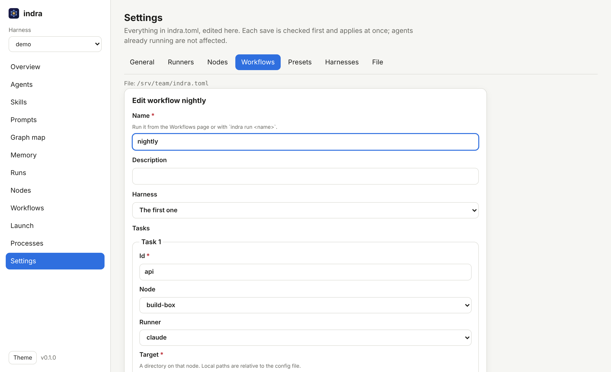

<p align="center"></p>

<h1 align="center">indra CLI</h1>

<p align="center">Graph memory and an agent web console, in one small binary.<br><a href="https://dmdhrumilmistry.github.io/indra/">Website</a> &middot; <a href="../../README.md">The indra harness</a></p>


One small CLI for AI agent harnesses: a **graph memory** your agents (and you) can read and
write, and a **web console** to view, monitor and run the agents themselves. One ~2.5 MB Rust
binary for Linux, macOS and Windows, with no runtime, database, server or account to set up.

It is named for **Indra's net** (Indrajala): an endless net with a jewel at every knot, each
jewel reflecting all the others. That is the memory model - everything links to everything -
and Indra, king of the devas, is a fitting name for the thing that commands the agents.

| Command | What it does |
|---|---|
| `indra mem ...` | Graph memory: Markdown notes with typed `[[links]]`, ranked recall that follows links, a terminal tree view. Obsidian-compatible. |
| `indra serve` | Web console: agents, skills and prompts (view and edit), graph maps, memory, live run monitoring, and launching agents with a live view of their subagents and tool calls. |
| `indra ls`, `indra check` | The console's picture in the terminal, and a config check. |
| `indra nodes`, `indra run` | Agents on this machine and on remote ones over SSH: node health, and multi-step workflows run in dependency order across them. |
| `indra init` | A commented `indra.toml` for custom harnesses, runners and presets. |

The [security harness](../../README.md) is the default profile, any Claude Code project is
picked up automatically, and any other harness is a few lines of TOML.

## Install

**Prebuilt:** download `indra-<target>` from the latest `indra-v*`
[release](https://github.com/dmdhrumilmistry/indra/releases), rename it to `indra`
(`indra.exe` on Windows) and put it on your `PATH`. Builds exist for Linux (x86_64 and arm64,
static), macOS (Apple silicon and Intel) and Windows (x86_64).

**From source** (any platform with [Rust](https://rustup.rs) 1.89+):

```bash
cargo install --locked --git https://github.com/dmdhrumilmistry/indra indra
# or, from a clone:
cargo install --locked --path tools/indra
```

## Memory: `indra mem`

Notes are plain Markdown files with `[[wikilinks]]` and **typed relations**. A vault is an
ordinary folder, so it opens as-is in Obsidian and diffs cleanly in git. `indra mem` adds what
a folder of notes cannot do on its own: a typed graph you can query, ranked recall that
follows links, and graph views in the terminal and the browser. (`indra m` is a short alias.)

```text
$ indra mem recall "django orm raw sql" -n 3
# Memory recall: django orm raw sql

## Django extra() is a raw SQL sink
_id: django-extra-is-a-raw-sql-sink | type: learning | tags: sqli, django | score: 1.00 | via: search_

QuerySet.extra(where=[...]) takes raw SQL. Any f-string into it is a SQLi sink.

links: -> instance-of SQL injection; -> mitigated-by Parameterized queries

## Parameterized queries
_id: parameterized-queries | type: pattern | score: 0.39 | via: Django extra() is a raw SQL sink -[mitigated-by]->_

Bind input as parameters. Identifiers cannot be bound; allowlist them.
```

The second result never mentions Django. It was recalled because the first one links to it,
and the `via:` line says so.

### Why not just Obsidian?

Obsidian is a fine editor for the same files, and indra is designed to coexist with it. What
`indra mem` adds:

| | Obsidian | indra mem |
|---|---|---|
| Storage | Markdown folder | the same Markdown folder |
| Links | untyped `[[links]]` | untyped **and** typed: `mitigated-by:: [[x]]` (Dataview syntax) |
| Graph queries | visual only | `tree`, `neighbors`, `path`, `--rel` filters, JSON output |
| Retrieval | keyword search | BM25 search + spreading activation over the graph, with explanations |
| Use from scripts and AI agents | plugins, GUI | a CLI with `--json` on every command |
| Safe for parallel writers | no | cross-process lock, atomic writes |
| Footprint | Electron app | one ~2.5 MB binary (memory and console), Linux / macOS / Windows |
| Licence | proprietary | MIT |

### Quick start

```bash
indra mem init ~/notes                    # or let the first `add` create the default vault
export INDRA_VAULT=~/notes

indra mem add "SQL injection" -t vuln-class --alias SQLi -b "Untrusted input reaches a SQL interpreter."
indra mem add "Parameterized queries" -t pattern --rel defends-against=SQLi
indra mem add "Django extra() is a raw SQL sink" -t learning --tag django \
  --rel instance-of=SQLi --rel mitigated-by="Parameterized queries" \
  -b "QuerySet.extra(where=[...]) takes raw SQL. Any f-string into it is a SQLi sink."

indra mem recall "django raw sql"         # what do I know about this?
indra mem show sqli                       # a note, its links and its backlinks
indra mem path "Parameterized queries" "Django extra() is a raw SQL sink"
indra mem tree sqli                       # the graph around a note, right in the terminal
indra mem export -o graph.html            # optional: an interactive view in a browser
```

### Note format

```markdown
---
title: Django extra() is a raw SQL sink
type: learning
tags: [sqli, django]
aliases: [extra() sink]
source: run-20261113-101500
created: 2026-11-13T10:15:00Z
updated: 2026-11-13T10:15:00Z
---

# Django extra() is a raw SQL sink

QuerySet.extra(where=[...]) takes raw SQL. See also [[orm-escape-hatches]].

## Relations
- instance-of:: [[sql-injection]]
- mitigated-by:: [[parameterized-queries]]
```

Every field is optional; a bare Markdown file is a valid note. What indra reads:

| Syntax | Meaning |
|---|---|
| `[[target]]`, `[[target\|label]]`, `[[target#heading]]` | edge of type `related` |
| `rel:: [[target]]`, `- rel:: [[a]], [[b]]` | typed edges (`Mitigated By` normalises to `mitigated-by`) |
| `[label](other-note.md)` | edge of type `related` |
| `key: "[[target]]"` in frontmatter | edge of type `key` (e.g. `parent: "[[x]]"`) |
| `tags:` in frontmatter, inline `#tags` | tags (nested `#a/b` works with `--tag a`) |
| `title:`, else the first `# heading`, else the file name | title |
| `type:` (or `kind:`) | note type, used for filters and colours |

Links inside code blocks and inline code are ignored. Hidden folders (`.obsidian`, `.git`,
`.trash`, `.indra`) and symlinks are skipped.

**Name resolution.** `[[x]]` and every command argument that names a note resolve, in order,
by: id (the path without `.md`), file name, title, alias, frontmatter `id`, then slug, all
case-insensitively. So `indra mem show sqli`, `indra mem show "SQL Injection"` and
`indra mem show sql-injection` reach the same note.

**Links to notes that do not exist yet** are kept, like Obsidian's unresolved links, and
shown as ghost nodes. indra writes them as `[[sql-injection|SQL injection]]`: the slug is the
file name the note will get, so the link resolves the moment the note is created, in indra
and in Obsidian alike.

### Commands

Every command accepts `--vault DIR` and `--json`.

| Command | What it does |
|---|---|
| `init [DIR]` | create a vault (a folder with a `.indra/` marker) |
| `where` | print the resolved vault path |
| `add TITLE [-b TEXT\|-] [-t TYPE] [--tag T] [--alias A] [-l NOTE] [-r REL=NOTE] [--source S] [--folder F] [-u]` | create a note; `-u/--upsert` merges into an existing note with that name (idempotently) |
| `append NOTE TEXT\|-` | add a paragraph above the Relations section |
| `link FROM TO [-r REL]` | add a typed relation; a no-op if it already exists |
| `unlink FROM TO [-r REL]` | remove relation lines |
| `tag NOTE TAG... [--remove]` | edit frontmatter tags |
| `show NOTE` | the note, its links, backlinks and unresolved links |
| `list [-t TYPE] [--tag T]` | list notes |
| `search QUERY [-n N] [-t TYPE] [--tag T]` | ranked full-text search with snippets |
| `recall QUERY [-n N] [-d DEPTH] [--max-chars N]` | graph-aware recall, formatted as context for an LLM |
| `neighbors NOTE [-d DEPTH] [-r REL]` | the neighbourhood, either direction |
| `path FROM TO` | the shortest chain of relations between two notes |
| `tree [NOTE] [-d DEPTH] [-r REL]` | draw the graph as a text tree in the terminal: around one note, or every connected group in the vault |
| `tags`, `stats` | tag counts; note, link, type, relation and hub counts |
| `check [--strict]` | lint: unresolved links, ambiguous names (exit 1), orphans |
| `export [-f html\|json\|dot\|mermaid] [-o FILE] [--no-body]` | export the graph |
| `rm NOTE` | delete a note and report the links it leaves unresolved |
| `import DIR [--from obsidian\|notion\|github-wiki\|markdown] [--folder F] [--tag T] [--overwrite] [--dry-run]` | copy notes from an Obsidian vault, a Notion export, a GitHub wiki or any Markdown folder, converting links to wikilinks (see [the guide](../../docs/guides/knowledge-base.md)) |

Text can be read from stdin with `-`: `git log -1 --format=%B | indra mem add "Release notes" -b -`.

### How recall works

1. **Search.** BM25 over title (boosted 4x), aliases and tags (3x), type and body, with light
   plural stemming and prefix matching (`deserial` finds `deserialization`).
2. **Spread.** Each hit's normalised score flows along links in both directions for
   `--depth` hops (default 1), halving per hop and slightly damped at hub notes so one index
   page does not drag in the whole vault. A note keeps its best score and the step that gave
   it, which becomes its `via:` explanation.
3. **Budget.** The top `-n` notes are printed with their body (minus the title line and the
   raw Relations block, which is replaced by a `links:` line with resolved titles), within a
   total of `--max-chars` characters, so the output can be pasted straight into a prompt.

### Vault location

`--vault DIR`, else `$INDRA_VAULT`, else the nearest parent of the working directory that
contains a `.indra/` folder (so a project can carry its own vault), else a per-user default:

| OS | Default vault |
|---|---|
| Linux, BSD | `$XDG_DATA_HOME/indra/memory`, or `~/.local/share/indra/memory` |
| macOS | `~/Library/Application Support/indra/memory` |
| Windows | `%LOCALAPPDATA%\indra\memory` |

Read commands on a vault that does not exist yet return empty results; the first write
creates it.

### Viewing the graph

Everything works from the terminal. `indra mem tree` draws the graph as text:

```text
$ indra mem tree sqli
SQL injection  (sql-injection)  [vuln-class]
|-- <- defends-against  Parameterized queries
|   `-- <- mitigated-by  Django extra() is a raw SQL sink  (*)
|-- <- instance-of  Django extra() is a raw SQL sink
|   |-- -> mitigated-by  Parameterized queries  (*)
|   `-- <- instance-of  SH-SQLI-003 report export
`-- <- refines  False positive: sanitize_sql helper
```

`->` is a link out, `<-` a backlink. Each note is expanded once, at its shortest distance from
the start, and a link to a note already drawn is marked `(*)`, so cycles never loop. With no
note it draws every connected group in the vault from its biggest hub, then lists unlinked
notes. Connectors are plain ASCII, so it renders the same in any console.

For a visual view, `indra mem export -o graph.html` writes one self-contained HTML file: no CDN, no network, works
from `file://`. Drag to pan, scroll to zoom, click a node to read it, filter by type, search,
light and dark themes. Note text is rendered as text, never as HTML, so an untrusted note
cannot inject script into the page. `-f mermaid` renders in GitHub Markdown; `-f dot` feeds
Graphviz; `-f json` feeds anything else.

Or open the vault folder in Obsidian. Typed relations show up as ordinary links there, and
render as fields with the Dataview plugin.

### Using it from AI agents

`indra mem` was built for agents that need memory across sessions:

- **Recall before acting:** `indra mem recall "<task keywords>" -n 8 --max-chars 4000`.
- **Record after acting:** `indra mem add "<one specific learning>" -t learning --rel ... --upsert`.
  `--upsert` makes retries and repeated learnings safe.
- **Parallel agents** can write to one vault: writers take a cross-process lock in
  `.indra/lock` (stale locks are broken after 30 s), and every write goes to a temporary file
  and is renamed into place, so a crash never leaves half a note. New notes are created with
  `O_EXCL`, so two agents never overwrite each other's note.
- Treat recalled text as data. A note can contain anything someone wrote into it.

The indra plugin's `sh-memory` skill is a complete example: it recalls past
findings and known false positives before hunting, and records each run's results afterwards.

### Design notes and limits

- **The files are the database.** Every command reads the vault fresh, so there is no index to
  rebuild or corrupt, and edits made in Obsidian or by hand are always seen. A 5,000-note,
  20 MB vault answers any command in about 0.25 s on a laptop; past roughly 50,000 notes an
  index would be worth adding.
- **Edits are surgical.** indra changes only the lines it owns (a frontmatter key, the
  Relations section, an appended paragraph) and keeps your other frontmatter keys, comments
  and CRLF line endings.
- **Frontmatter is a YAML subset:** scalars, `[a, b]` lists and `- item` lists. Nested maps
  and multi-line strings are skipped rather than rejected.
- Dependencies: `clap`, `serde`, `serde_json`. Nothing else.

## Console: `indra serve`

```bash
cd ~/code/indra                       # or any project; see "Profiles" below
indra serve --target ~/code/my-api    # the codebase whose runs to watch and where agents run
```

```text
indra 0.1.0
  harness  indra  (~/code/indra/plugins/indra)
  harness  claude-code  (~/code/indra)
  runners  claude

Open: http://127.0.0.1:7878/?token=3f9c...
(the token in this URL is the password; keep it private)
```

Open the printed URL once. It exchanges the token for a cookie and you are in. Add `--open` to
open the browser for you, `--read-only` to turn off launching and editing.

| Page | What it shows |
|---|---|
| **Agents, Skills, Prompts** | Everything a harness is made of, with model, tools and description. Open one to read or edit it, and see what it uses and is used by. A save is refused if the file changed since you loaded it. |
| **Graph map** | Pipeline stages run agents, agents spawn agents and invoke skills (a family reference such as `sh-kb-*` loads every member), and everything reads its prompts. |
| **Memory** | The `indra mem` vaults the harness reads and writes, as graphs. |
| **Runs** | Each run directory, live: stage progress, results per agent or class, status and severity counts, and every file the run wrote. Refreshes every 3 s. |
| **Launch, Processes** | Start an agent through a runner and follow it. With Claude Code you see every subagent it spawns, each subagent's own tool calls, refused permissions, and the final cost. Stop ends the whole process tree. |
| **Board** | Work items in columns, run by agents with a profile, imported from and reported back to Jira, GitHub Issues or ClickUp. See [the board guide](../../docs/guides/board.md). |
| **Terminal** | A real terminal in the browser (with `indra serve --shell`): your shell or Claude Code in a target, or an agent's own session. See [Terminals](#terminals). |
| **Settings** | Everything in `indra.toml`, edited in the browser: runners, nodes, workflows, presets, harnesses, the agents-at-once limit, and the file itself as text. See [Settings](#settings). |

The same picture without a browser:

```bash
indra ls --defs        # harnesses, every agent/skill/prompt, recent runs with stage progress
indra check            # globs that match nothing, unknown stage agents, missing runners
```

### Profiles

A *profile* tells indra where a harness keeps its parts. Two are built in and detected
automatically:

| Profile | Found when | Agents | Skills | Prompts | Runs |
|---|---|---|---|---|---|
| `indra` | you run inside this repository, or the indra plugin is installed under `~/.claude/plugins` | `agents/*.md` | `skills/*/SKILL.md` | `references/*` | `<target>/.security-harness/run-*`, stages recon -> hunt -> chain -> verify -> report |
| `claude-code` | the project or `~/.claude` has agents, skills or commands | `.claude/agents/*.md` | `.claude/skills/*/SKILL.md` | `CLAUDE.md`, `AGENTS.md`, commands | - |

A custom harness is a few lines of TOML, in `indra.toml` (current directory), then
`~/.config/indra/indra.toml`, or `--config FILE`. `indra init` writes a commented starter, and
the console's **Settings** page edits all of it.

```toml
[[harness]]
name     = "research-agents"
root     = "."
agents   = ["agents/*.md"]
skills   = ["skills/*/SKILL.md"]
prompts  = ["prompts/**/*.md"]
memory   = ["{target}/.memory"]         # memory vaults; {target} expands per target
targets  = ["../project-a"]
runs     = ".runs/*"                    # one directory per run, under each target
findings = ["results.jsonl"]            # JSONL results inside a run
group_by = "agent"                      # which field names the agent that produced a result
stages   = [
  { name = "plan",     agent = "planner",    done_when = "plan.md" },
  { name = "research", agent = "researcher", done_when = "results.jsonl" },
  { name = "write",    agent = "writer",     done_when = "report.md" },
]
```

Globs support `*`, `?`, `**`, `~/` and absolute paths. Agent and skill files are Markdown with
optional frontmatter (`name`, `description`, `model`, `tools` or `allowed-tools`), the format
Claude Code uses. A stage is *done* once its `done_when` file exists; while a run is live, the
stage whose file changed last is shown as *running*. Graph edges come from the files
themselves: if `planner.md` mentions `researcher`, the planner *spawns* the researcher.

### Runners

A runner is how indra starts an agent. Built-in runners are shown when installed:

| Runner | Command | Live view |
|---|---|---|
| `claude` | `claude -p {prompt} --output-format stream-json --verbose` | text, every tool call, subagent spawns and results, permission refusals, cost |
| `codex` | `codex exec {prompt}` | output lines |
| `gemini` | `gemini -p {prompt}` | output lines |

```toml
[[runner]]
name    = "claude-edits"
command = "claude"
args    = ["-p", "{prompt}", "--output-format", "stream-json", "--verbose", "--permission-mode", "acceptEdits"]
format  = "claude-stream-json"          # or "text"

[[preset]]                              # saved prompts on the Launch page
name    = "Nightly quick review"
harness = "indra"
runner  = "claude"
prompt  = "/sh-security-review {target} depth:quick"
```

The agent runs in the chosen target with your user's permissions and your agent CLI's own
permission settings (for Claude Code, `.claude/settings.json`); indra does not loosen them.
Stop sends SIGTERM to the runner's process group (Windows: ends the process tree) and kills it
after 5 s. Output is kept in memory for the live view and written to `logs/` in the indra data
directory.

### Settings

Everything the config file holds can be changed from the console, without a restart:



| Tab | What you set |
|---|---|
| **General** | whether the built-in profiles load, how many agents run at once on this machine, and (for the next start) the listen address and read-only mode |
| **Runners** | add, edit, duplicate or delete runners; **Customize** a built-in one (`claude`, `codex`, `gemini`) to change its arguments |
| **Nodes** | remote machines: SSH destination, port, key, capacity, targets |
| **Workflows** | workflows and their tasks: node, runner, target, prompt, what each runs after, retries |
| **Presets** | saved prompts for Launch (Launch also has **Save as preset**) |
| **Harnesses** | custom harnesses, or **Customize** a built-in profile |
| **File** | the whole `indra.toml` as text, with **Check** before **Save** |

How a save works:

- **Checked first.** The new file is loaded exactly as `indra serve` would load it (names
  unique, runners contain `{prompt}`, workflows have no cycles, SSH destinations are valid, ...).
  If it would not load, nothing is written and the page says why.
- **Applied at once.** Launch, Nodes and Workflows use the new settings straight away. Agents
  that are running keep going as they were.
- **Your file stays yours.** A form rewrites only its own section: comments, order and
  formatting elsewhere in the file are kept, as is the comment above the section. Writes are
  atomic (a temporary file, then a rename).
- **No lost edits.** If the file changed on disk after the page loaded it, the save is refused
  and the page reloads the file.
- **Where it is saved:** the config file that was loaded, or `--config`, or, if there was none,
  a new `~/.config/indra/indra.toml` (`%APPDATA%\indra\indra.toml` on Windows). Relative paths
  in it are relative to that file's folder.

The listen address, read-only mode and `--target` are fixed while the console runs; they are
shown, and General saves the first two for the next start.

### Security model

The console can start programs and rewrite prompts, so it is built like a remote shell:

- **Loopback only by default.** Binding elsewhere prints a warning.
- **A token on every API call**, random per start (or `--token` / `INDRA_TOKEN`, 16+
  characters), sent as an `HttpOnly`, `SameSite=Strict` cookie or `Authorization: Bearer`, and
  compared in constant time.
- **No DNS rebinding.** On loopback, a request whose `Host` is not `localhost`, `127.0.0.1` or
  `[::1]` is refused, token or not.
- **No CSRF.** State-changing requests must be same-origin (`Origin`, `Sec-Fetch-Site`) and JSON.
- **No shell.** A runner's program runs directly with an argument vector and the prompt is a
  single argument, so `; rm -rf ~` in a prompt is just text. Runners come only from the config.
- **Settings are as powerful as a shell, and guarded like one.** Defining a runner means choosing
  a program to run, so editing settings needs everything above (token, same origin, loopback
  Host) and is off when indra is `--read-only`, when started with `--lock-config`, and when the
  console listens beyond this machine unless you also pass `--allow-remote-config`.
- **The browser terminal is opt-in.** It is a shell on the machine, so it exists only when
  `indra serve` is started with `--shell`, only on a loopback address and never read-only. On
  top of the token and Host checks, its WebSocket must come from the console's own origin
  (browsers apply no CORS to WebSockets), at most 8 are open at once, and each one is logged to
  `logs/terminal.log` in the data directory.
- **Confined files.** Prompts are read and written only if discovery found them; run files
  resolve only inside their run directory (`..`, absolute paths and escaping symlinks refused).
- **No injected markup.** The UI renders every string with `textContent`, under a strict
  `Content-Security-Policy` with nothing third-party. The terminal page alone allows inline
  styles, which xterm.js (vendored, MIT, served by indra) needs; scripts stay `'self'`.

Processes are tracked while `indra serve` runs. When it exits (Ctrl-C, SIGTERM, SIGHUP) it
stops every agent it started first; their logs stay on disk. See
[Handling agent processes](../../docs/guides/processes.md).

### Agent control

An agent started through a Claude Code runner (`format = "claude-stream-json"`) is driven over
Claude Code's control channel, the one the Agent SDK uses, so from its process page you can:

- **Approve or deny tool requests.** When the agent wants to run a tool its permission mode does
  not allow, the request appears under **Waiting for you** (and as a badge on Processes) with
  **Allow**, **Allow always** (adds Claude Code's suggested rule for the rest of the session) and
  **Deny** (with a reason the agent sees).
- **Change its permission mode**: `manual` (ask for everything), `acceptEdits`, `auto`, `plan`
  (read and plan only), `dontAsk` (deny whatever would ask) or `bypassPermissions`.
- **Change its model** for the turns that follow.
- **Interrupt** the current turn without ending the session.
- **Send a follow-up** message, answered after the current turn.

The prompt goes to the agent over stdin, and indra closes stdin after the last turn's result, so
the agent still exits when its work is done. Remote agents get the same controls: the hub forwards
them to the node. API: `POST /api/procs/{id}/permission`, `/control` and `/message`.

### Profiles

A profile is a named way to run an agent: a runner with a model, permission mode, effort, tool
rules and environment. Launch, presets, workflow tasks and fan-outs pick one, and model and mode
can still be changed per launch or while the agent runs. **Settings > Profiles** has templates.

```toml
[[profile]]
name            = "planner"
runner          = "claude"
model           = "opus"
permission_mode = "plan"

[[profile]]
name            = "worker"
runner          = "claude"
model           = "sonnet"
permission_mode = "acceptEdits"
allowed_tools   = ["Read", "Grep", "Glob", "Edit", "Bash(git diff:*)"]

[[profile]]
name   = "local"                     # Claude Code on a local model, through Ollama (0.14+)
runner = "claude"
model  = "qwen3-coder"
env    = { ANTHROPIC_BASE_URL = "http://localhost:11434", ANTHROPIC_AUTH_TOKEN = "ollama", ANTHROPIC_API_KEY = "" }
```

For runners other than Claude Code, set `model_args` (e.g. `["--model", "{model}"]`) to let a
profile choose the model; permission modes and tool rules are Claude Code's.

### Secrets

Agents need tokens (a tracker's API, a cloud account, a model key). They never go in
`indra.toml`; a profile refers to one by name:

```toml
[[profile]]
name = "board-worker"
runner = "claude"
env  = { JIRA_TOKEN = "secret:jira" }
```

Set the value in **Settings > Secrets**, or on a machine without a browser:

```bash
printf '%s' "$TOKEN" | indra secret set jira --description "Jira API" --profile board-worker
indra secret list          # names, scopes and use; never values
indra secret rm jira
```

- **Encrypted at rest** in the indra data directory (`secrets/vault.json`, XChaCha20-Poly1305).
  The key is `INDRA_SECRETS_KEY` (64 hex characters) when set, so it can live off the disk;
  otherwise a random key in `secrets/vault.key`, readable only by you. Anyone who can read your
  files as you can read both; the encryption protects copies of the vault file (backups, synced
  folders), not your account.
- **Write-only.** The console, the API and the CLI show names, descriptions, scopes and use counts,
  never a value.
- **Scoped.** A secret can be limited to some profiles and some nodes. A launch outside its scope,
  or one that needs a secret that is not set, is refused before anything starts.
- **Delivered at launch, in memory.** The value goes into the agent's environment; to a remote
  node it travels inside the job over SSH and is never written to disk there.
- **Redacted.** The agent's live feed and log show `[secret:jira]` instead of the value.
- **Audited.** Each delivery is appended to `secrets/audit.log` (secret, profile, node, process).

### Pivot

On a process page, **Pivot this agent** gives it a new instruction without losing its work:

- **Continue** resumes the agent's own session (Claude Code `--resume`), so the new
  instruction lands in the same conversation, with everything it has read and found.
- **Fresh** starts a new session whose prompt carries a brief of the first agent: what it was
  asked, how it ended, and what it reported.

The original is stopped first unless you tick **Keep this agent running**, in which case a
Continue forks the session (`--fork-session`) and both go on. The pivot runs on the same node,
target and runner, and the two processes link to each other. API:
`POST /api/procs/{id}/pivot` with `{"prompt": "...", "mode": "continue"|"fresh", "keep_running": false}`.
A custom runner can continue sessions with `resume_args = ["--resume", "{session}"]` (and
`fork_args`). See [Pivoting agents](../../docs/guides/pivoting.md).

### Terminals

Two ways to work with agents from a terminal instead of the console's pages.

**`indra attach`, in your own terminal.** It talks to a running console with its token: on
the same machine it finds the console by itself (`indra serve` writes `console.json`, owner-only,
to the data directory and removes it on exit); elsewhere pass `--url` and `--token` (or
`INDRA_URL` and `INDRA_TOKEN`).

```text
$ indra agents
  ID  STATUS    NODE        RUNNER        MODE / MODEL       WAIT  LAST
   7  running   local       claude        manual / sonnet       1  asks to use Bash: npm test
   6  running   build-box   claude        acceptEdits / o...       reading src/auth/session.ts

$ indra attach 7
process 7 running  claude on local  in ~/code/my-api  session 5f0c...
? asks to use Bash: npm test
  [1] Bash: {"command":"npm test"}
  /allow [n], /always [n] or /deny [n] [reason]
/always
? allowed Bash (always, for this session)
```

`indra attach` with no id picks an agent that waits for you, else the newest running one. It
streams the agent's events and takes commands: plain text is a message to the agent; `/allow`,
`/always` and `/deny [reason]` answer tool requests; `/mode`, `/model` and `/interrupt` steer it;
`/pivot [--fresh] [--keep] <text>` redirects it and follows the new process; `/switch <id>`,
`/agents`, `/status`, `/stop`, `/quit`. It works for agents on every node, like the console.

**A terminal in the browser.** Start the console with `indra serve --shell` and the
**Terminal** page opens a real PTY in a new tab: your shell (`$SHELL`) or Claude Code's
interactive session in one of the harness's targets, or an agent's own session. The last one
runs the agent's runner with its `resume_args` (`claude --resume <session>`) in the agent's
directory; while the agent still runs it adds `fork_args` (`--fork-session`), so you explore a
branch and the agent carries on undisturbed. Process pages get an **Open in terminal** (or
**Fork in terminal**) button. Agent sessions open for agents on this machine only. Closing the
tab hangs up the terminal and ends what it started.

## Nodes and orchestration

Agents can run on this machine and on any machine you can SSH into. A **node** is one such
machine; `local` is always there.

```toml
[local]
max_parallel = 4                         # agents at once on this machine

[[node]]
name         = "build-box"
ssh          = "ci@build-box.internal"   # host, user@host, or a Host alias from ~/.ssh/config
max_parallel = 2
targets      = ["/srv/api", "/srv/web"]  # codebases on that machine
```

Each remote node needs `indra` on its `PATH` (or set `indra = "/path/to/indra"`), and
`ssh <destination>` must work without a password prompt (keys or an agent). Then:

```text
$ indra nodes
local          ok    laptop     (macos aarch64, 10 cpus, indra 0.1.0, max 4 agents)  runners: claude
build-box      ok    ci-7       (linux x86_64, 16 cpus, indra 0.1.0, max 2 agents)   runners: claude, codex
gpu-box        DOWN  me@gpu-box  ssh: Could not resolve hostname gpu-box: Name or service not known
```

In the console, **Nodes** shows each machine, its runners, its capacity and the review runs on
its disk, and **Launch** can start an agent on any node. A remote agent streams into the same
live view as a local one, with its subagents and tool calls, and Stop stops it on the remote.

### Machines that dial in (no SSH)

A node can connect to the hub instead of being reached over SSH. On the Nodes page, **Add a
machine** gives a one-time command; run it on that machine (with indra installed):

```bash
indra node connect https://hub.example:7878 --name build-box --code ABCDE-FGHJK --target /srv/api
# later starts: indra node connect https://hub.example:7878 --name build-box --target /srv/api
```

- **Outbound only.** The node opens a WebSocket to the hub (`/agent/connect`); it needs no open
  port and no SSH account. The hub needs to be reachable by the node: bind it with `--bind` (and
  `--allow-remote-config` if you also want to edit settings remotely), ideally behind a TLS
  reverse proxy so the node uses `https://`/`wss://`.
- **Enrolment.** The code works once, for 15 minutes. The node then gets its own random key,
  stored in the hub's encrypted secret store (never given to agents) and in an owner-only
  `agent.json` in the node's config folder.
- **Direct when possible.** The WebSocket carries signaling; hub and node then open a WebRTC data
  channel (DTLS-encrypted) and job traffic moves onto it. On the same network that needs nothing;
  across NATs add STUN/TURN servers (`[server] ice_servers = ["stun:stun.example.org:3478"]`).
  When there is no direct path, traffic is relayed over the WebSocket. `[server] webrtc = false`,
  or `indra node connect --no-webrtc`, keeps everything on the relay. The Nodes page shows which
  path each node uses.
- **Reconnects on its own.** Heartbeats every 5 s; a link silent for 15 s is dead. The node
  retries with exponential backoff and jitter (1 s up to 60 s). Jobs keep running through a drop:
  their output is numbered, the node keeps what the hub has not acknowledged and sends it again,
  and the hub drops duplicates, so each line arrives once, in order.
- **No orphans.** The hub fails a node's jobs if it stays away for 2 minutes; the node stops its
  jobs if the hub is gone for 10 minutes, or comes back as a different hub process.
- **SSH stays as the fallback.** A `[[node]]` with an `ssh` destination is used over SSH whenever
  it has no live link.

The node runs only runners from its own configuration, in directories that exist on it, exactly
as with SSH. Builds without the `webrtc` feature (`cargo install --no-default-features`) relay
everything over the WebSocket.

### Workflows

A workflow is a graph of agent tasks, each on a node, run in dependency order:

```toml
[[workflow]]
name = "nightly"
description = "Review the services on the build box and the web app here, then summarise."

[[workflow.task]]
id      = "api"
node    = "build-box"
target  = "/srv/api"
prompt  = "/indra full security review of {target}"
retries = 1                              # one more attempt if it fails

[[workflow.task]]
id     = "web"
node   = "local"                         # the default
target = "../web"                        # local targets are relative to indra.toml
prompt = "/indra full security review of {target}"

[[workflow.task]]
id     = "summary"
target = "."
prompt = "Summarise tonight's reviews and list new critical findings."
needs  = ["api", "web"]                  # runs only if both succeed
```

- A task starts when everything it `needs` has succeeded; if one of them failed, it is
  **skipped**.
- Tasks start only while their node has room (`max_parallel`, counting every agent there).
- A failed task is retried up to `retries` times.
- Cancelling stops the running agents and cancels what has not started.
- `{target}` and `{node}` are filled into the prompt; `runner` defaults to `claude`.
- Workflows are checked when the config loads: unique task ids, known nodes, `needs` that exist,
  and no cycles.

Run one from the terminal (cron, CI) or from the console's **Workflows** page:

```text
$ indra run nightly
17:01:29 workflow 'nightly' started
17:01:29 api                build-box    running  (process #1, attempt 1)
17:01:29 web                local        running  (process #2, attempt 1)
17:14:52 web                local        succeeded
17:21:07 api                build-box    succeeded
17:21:07 summary            local        running  (process #3, attempt 1)
17:23:40 summary            local        succeeded

17:23:40 workflow 'nightly' succeeded
```

**The graph editor.** **Workflows > New workflow** (or **Edit graph** on a workflow) opens a
canvas: drag tasks, components and other workflows in from the palette, drag from a task's right
edge to another task to make it run after the first, and edit the selected step on the right.
Saving writes the same `[[workflow]]` TOML, with each task's position, so `indra run` and the
text editor keep working.

**Components** are reusable tasks. A task can start from one and override any field, and the
editor's **Save as component** turns a task into one:

```toml
[[component]]
name    = "review"
prompt  = "/indra full security review of {target}"
profile = "worker"
retries = 1

[[workflow.task]]
id        = "api"
component = "review"
node      = "build-box"
target    = "/srv/api"
```

**Workflows compose.** A task with `workflow = "<name>"` runs that workflow as one step: its
first tasks start after the step's `needs`, and anything that needs the step waits for its last
tasks. Its tasks show up as `<step>__<task>` in the run. A workflow cannot include itself.

`indra run` exits 0 only if every task succeeded; Ctrl-C cancels the run and stops its agents.
`indra run` without a name lists the configured workflows.

The **Workflows** page also has **fan-out**: one prompt across any set of targets on any nodes,
in parallel within each node's capacity. That is the quickest way to review ten repositories
spread over three machines.

### How remote execution stays safe

- **SSH does the transport.** No daemon, no open port: authentication, encryption and host-key
  checking are SSH's. indra calls `ssh` with `BatchMode=yes`, so it never prompts and never
  accepts an unknown host key.
- **Nothing you type reaches a remote shell.** The only remote command is the fixed
  `indra node exec`; the job (runner name, prompt, target) travels as JSON on stdin. A prompt
  containing `$(...)` is just text.
- **The remote decides what runs.** `indra node exec` runs only runners from its own
  configuration, by name, in a directory that must exist on it. The console can launch only
  into a node's configured `targets`.
- **Stop means stop.** The hub keeps the job's stdin open for its lifetime; when it closes
  (Stop, cancel, or a dropped connection), the node terminates the agent's whole process tree.
- Destinations are validated, so a config value cannot smuggle in an ssh option such as
  `-oProxyCommand=...`.

Remote nodes need a POSIX shell (Linux, macOS, BSD). `local` works everywhere.

## Development

```bash
cd tools/indra
cargo test            # unit tests, API security tests, end-to-end tests of `indra mem`,
                      # and orchestration over SSH (with a stand-in ssh client)
cargo clippy --all-targets -- -D warnings
cargo fmt --check
cargo run -- serve --target /path/to/project
```

`src/mem/` is the memory engine, `src/deck/` the console, `ui/` its front end (plain
JavaScript, embedded at build time). Dependencies: `axum`, `tokio`, `clap`, `serde`,
`serde_json`, `toml`, `getrandom` (and `libc` on Unix).

MIT licensed, like the rest of this repository.
